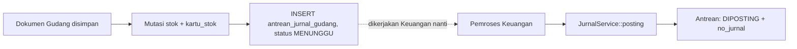

# Jawaban Keuangan untuk Tim Gudang: Integrasi Jurnal Gudang → Keuangan

> **Untuk tim Gudang dan asisten AI-nya.** Dokumen ini menjawab pertanyaan tim Gudang tentang mekanisme integrasi jurnal. Bagian [§7](#7-daftar-tugas-modul-gudang-yang-harus-dikerjakan-sekarang) berisi tugas yang harus dikerjakan modul Gudang **sekarang**. Bagian yang ditandai **[KEUANGAN]** akan dikerjakan tim Keuangan setelah wadah dari Gudang siap. Gudang tidak perlu mengerjakannya.

---

## Ringkasan pertanyaan Gudang

> Gudang mencatat transaksi dan mutasi stok, lalu menyediakan data sumber untuk diproses Keuangan. Gudang tidak membuat atau memposting jurnal dan tidak memanggil `JurnalService` langsung. Mekanisme apa yang dipakai Keuangan untuk menerima transaksi penerimaan barang, kerusakan/susut, dan opname? Apa format atau antreannya, status apa yang dikembalikan, dan bagaimana jurnal ditautkan kembali ke dokumen Gudang?

**Jawaban singkat:** kami setuju Gudang **tidak** memanggil `JurnalService`. Mekanisme yang dipakai adalah **tabel antrean (outbox) `antrean_jurnal_gudang`**:

1. **Gudang** membuat tabel ini (wadahnya) dan mengisi satu baris setiap kali transaksi stok terjadi.
2. **Keuangan** nanti membuat pemroses (Job/command) yang membaca antrean, memposting jurnal lewat `JurnalService`, lalu menulis status dan nomor jurnal kembali ke baris antrean.

Saat ini **belum ada** antrean atau service penerima di kodebase, jadi wadah ini yang pertama dibuat.



> [!IMPORTANT]
> Langkah B dan C wajib berada di **satu `DB::transaction`**. Kalau mutasi stok gagal, baris antrean ikut batal. Kalau stok berhasil, baris antrean pasti ada.

---

## 1. Mekanisme yang dipakai

| Pertanyaan | Jawaban |
|---|---|
| Lewat apa Gudang mengirim data? | Insert ke tabel `antrean_jurnal_gudang`. Bukan API, bukan pemanggilan service. |
| Kapan dikirim? | Di `store()` dokumen, di dalam transaksi yang sama dengan mutasi stok. |
| Siapa yang memposting jurnal? | Pemroses milik Keuangan **[KEUANGAN]**. |
| Apakah Gudang perlu tahu kode akun? | Tidak. Gudang cukup mengirim `id_unit_usaha` dan nilai. Akun persediaan ditentukan Keuangan dari unit usaha. |

---

## 2. Format data (struktur tabel dan isi)

### 2.1 Tabel yang dibuat Gudang

```php
Schema::create('antrean_jurnal_gudang', function (Blueprint $t) {
    $t->id('id_antrean');
    $t->foreignId('id_entitas')->constrained('entitas', 'id_entitas');
    $t->enum('jenis_transaksi', ['PENERIMAAN', 'KERUSAKAN', 'OPNAME_KURANG', 'OPNAME_LEBIH']);
    $t->string('ref_tipe', 30);              // PENERIMAAN | KERUSAKAN | OPNAME (sama dengan kartu_stok.ref_tipe)
    $t->unsignedBigInteger('ref_id');        // id_penerimaan | id_kerusakan | id_opname
    $t->string('no_dokumen', 30);            // kode dokumen yang dilihat user
    $t->foreignId('id_unit_usaha')->constrained('master_unit_usaha', 'id_unit_usaha');
    $t->date('tanggal');                     // tanggal dokumen (= tanggal jurnal)
    $t->decimal('nilai', 18, 2);             // total nilai/HPP, SELALU POSITIF
    $t->json('payload');                     // rincian barang

    // ---- Diisi oleh KEUANGAN. Gudang hanya membaca. ----
    $t->string('status', 20)->default('MENUNGGU');
    $t->unsignedBigInteger('id_jurnal')->nullable();
    $t->string('no_jurnal', 30)->nullable();
    $t->text('pesan_error')->nullable();
    $t->timestamps();

    $t->unique(['id_entitas', 'ref_tipe', 'ref_id', 'jenis_transaksi', 'id_unit_usaha'], 'antrean_idempoten');
    $t->index(['status', 'id_entitas']);
});
```

Model: `App\Models\Gudang\AntreanJurnalGudang` dengan `payload` di-cast ke `array` dan `tanggal` ke `date`.

### 2.2 Isi `payload`

```json
{
  "id_gudang": 1,
  "jenis_kejadian": "susut",
  "items": [
    {
      "id_barang": 12,
      "qty": 5.0,
      "hpp_satuan": 12000.0,
      "nilai": 60000.0,
      "id_kartu": 9812
    }
  ],
  "id_pembelian": null,
  "keterangan": "opsional"
}
```

| Field | Wajib | Keterangan |
|---|---|---|
| `id_gudang` | Ya | Gudang asal mutasi |
| `items[].id_barang` | Ya | |
| `items[].qty` | Ya | Dalam satuan dasar, positif |
| `items[].hpp_satuan` | Ya | Harga beli (penerimaan) atau `hpp_rata2` (kerusakan/opname) |
| `items[].nilai` | Ya | `qty × hpp_satuan`, positif |
| `items[].id_kartu` | Ya | `kartu_stok.id_kartu` hasil mutasi. Dipakai Keuangan untuk mengisi `kartu_stok.id_jurnal` |
| `jenis_kejadian` | Hanya kerusakan | `rusak` / `susut` / `hilang` / `kadaluarsa` |
| `id_pembelian` | Hanya penerimaan | Diisi kalau penerimaan berasal dari pembelian (lihat §5.1) |

### 2.3 Aturan pengisian

1. **Satu baris = satu dokumen × satu unit usaha × satu arah.** Dokumen dengan barang dari dua unit usaha menghasilkan dua baris.
2. **`nilai` = Σ `items[].nilai` = Σ `kartu_stok.nilai_mutasi`** untuk dokumen itu. Kalau berbeda, Keuangan akan menandai `GAGAL`.
3. **Nilai selalu positif.** Arah (tambah/kurang) dibaca dari `jenis_transaksi`.
4. **Nilai nol tidak dikirim.** Misalnya opname tanpa selisih tidak perlu baris antrean.

---

## 3. Status dari Keuangan

Gudang **hanya membaca** kolom status. Semua perubahan status dilakukan Keuangan.

| Status | Arti | Yang ditampilkan Gudang |
|---|---|---|
| `MENUNGGU` | Baru masuk antrean (nilai default dari Gudang) | "Menunggu jurnal" |
| `DIPROSES` | Sedang diproses Keuangan | "Diproses" |
| `DIPOSTING` | Jurnal berhasil dibuat; `no_jurnal` terisi | Nomor jurnal |
| `GAGAL` | Gagal diposting; alasan ada di `pesan_error` | Alasan gagal. Biasanya ditangani Keuangan (periode tutup, akun belum di-set) |
| `DIBALIK` | Jurnal sudah dibatalkan dengan jurnal pembalik | "Dibalik" |
| `DIBATALKAN` | Dibatalkan sebelum diposting | "Dibatalkan" |

---

## 4. Cara menautkan jurnal kembali ke dokumen Gudang

```text
Dokumen Gudang (ref_tipe + ref_id)
   └── antrean_jurnal_gudang  → status, id_jurnal, no_jurnal
          └── jurnal_header (source_type = AntreanJurnalGudang, source_id = id_antrean)   [KEUANGAN]
   └── kartu_stok.id_jurnal   → diisi Keuangan dari items[].id_kartu                     [KEUANGAN]
```

Yang dilakukan Gudang: tambahkan relasi di model dokumen dan tampilkan hasilnya di halaman detail.

```php
// Contoh di model KerusakanBarang (sama polanya untuk PenerimaanBarang dan OpnameHeader)
public function antreanJurnal()
{
    return $this->hasMany(AntreanJurnalGudang::class, 'ref_id', 'id_kerusakan')
        ->where('ref_tipe', 'KERUSAKAN');
}
```

---

## 5. Contoh kasus yang harus tercatat

Jurnal di bawah dibuat oleh **Keuangan**. Gudang cukup memastikan data antreannya seperti di kolom "Baris antrean dari Gudang".

### 5.1 Penerimaan barang: menambah persediaan

Contoh: `PNR-2026-11-0010`, unit Sembako, 100 kg beras @ Rp12.000.

| Baris antrean dari Gudang | Jurnal oleh Keuangan |
|---|---|
| `jenis_transaksi = PENERIMAAN`, `nilai = 1.200.000`, 1 item | Dr Persediaan Sembako 1.200.000 / Cr akun lawan (ditentukan Keuangan) |

> [!WARNING]
> Persetujuan pembelian sudah menjurnal `Dr Persediaan`. Supaya persediaan tidak tercatat dua kali, Gudang **wajib** mengisi `payload.id_pembelian` kalau penerimaan berasal dari pembelian. Saat ini `PenerimaanBarangController` selalu menyimpan `id_pembelian = null`; ini yang perlu diperbaiki. Keuangan akan memutuskan perlakuannya dari isian tersebut.
>
> Hanya **qty yang masuk stok** yang dihitung, sesuai `kartu_stok`. Barang tidak layak yang tidak masuk stok tidak ikut dihitung.

### 5.2 Kerusakan/susut: mengurangi persediaan dan mencatat kerugian

Contoh: susut 5 kg beras, HPP rata-rata Rp12.000.

| Baris antrean dari Gudang | Jurnal oleh Keuangan (template `KRG`) |
|---|---|
| `jenis_transaksi = KERUSAKAN`, `nilai = 60.000`, `jenis_kejadian = susut` | Dr 641 Biaya Kerusakan & Susut 60.000 / Cr Persediaan Sembako 60.000 |

### 5.3 Stok opname: menyesuaikan persediaan sesuai selisih fisik

Contoh `OPN-2026-11-0002` (unit Sembako):

| Barang | Sistem | Fisik | Selisih | HPP | Nilai |
|---|---|---|---|---|---|
| Beras | 200 | 195 | −5 | 12.000 | −60.000 |
| Gula | 50 | 52 | +2 | 15.000 | +30.000 |
| Minyak | 40 | 37 | −3 | 18.000 | −54.000 |

| Baris antrean dari Gudang | Jurnal oleh Keuangan |
|---|---|
| `OPNAME_KURANG`, `nilai = 114.000`, items: beras + minyak | `OPK`: Dr 641 114.000 / Cr Persediaan 114.000 |
| `OPNAME_LEBIH`, `nilai = 30.000`, items: gula | `OPL`: Dr Persediaan 30.000 / Cr 712 Selisih Lebih Opname 30.000 |

Selisih **tidak dinetto**: kurang dan lebih dikirim sebagai dua baris terpisah.

---

## 6. Batasan untuk modul Gudang

- ❌ Jangan memanggil `JurnalService` atau menulis ke `jurnal_header`/`jurnal_detail`.
- ❌ Jangan mengubah kolom `status`, `id_jurnal`, `no_jurnal`, atau `pesan_error`.
- ❌ Jangan mengubah atau menghapus dokumen maupun baris antrean yang sudah dibuat. Koreksi dibuat sebagai **dokumen baru**, yang akan menghasilkan baris antrean baru.
- ❌ Jangan mengisi `kartu_stok.id_jurnal`. Kolom itu diisi Keuangan.

---

## 7. Daftar tugas modul Gudang (yang harus dikerjakan sekarang)

- [ ] **Migrasi** `antrean_jurnal_gudang` sesuai §2.1.
- [ ] **Model** `App\Models\Gudang\AntreanJurnalGudang` (cast `payload` → array, `tanggal` → date, `BelongsToEntitas`).
- [ ] **`KerusakanBarangController::store()`**: insert 1 baris `KERUSAKAN` di dalam transaksi yang sama.
- [ ] **`OpnameController::store()`**: kelompokkan detail per unit usaha dan arah, lalu insert `OPNAME_KURANG` dan/atau `OPNAME_LEBIH`.
- [ ] **`PenerimaanBarangController::store()`**: kelompokkan per unit usaha, insert `PENERIMAAN`, dan isi `id_pembelian` kalau ada.
- [ ] Sertakan `id_kartu` dari hasil mutasi `kartu_stok` di setiap item.
- [ ] **Relasi** `antreanJurnal()` di model `PenerimaanBarang`, `KerusakanBarang`, dan `OpnameHeader`.
- [ ] **Tampilkan status jurnal** (status, no_jurnal, pesan_error) di halaman detail ketiga dokumen, hanya baca.
- [ ] **Uji:** kalau mutasi stok gagal, baris antrean tidak tercipta. Nilai antrean = Σ `kartu_stok.nilai_mutasi`.

**[KEUANGAN], dikerjakan setelah tugas di atas selesai:** Job pemroses antrean, template jurnal penerimaan, keputusan perlakuan penerimaan yang terkait pembelian, update status/`id_jurnal`, dan pengisian `kartu_stok.id_jurnal`.
