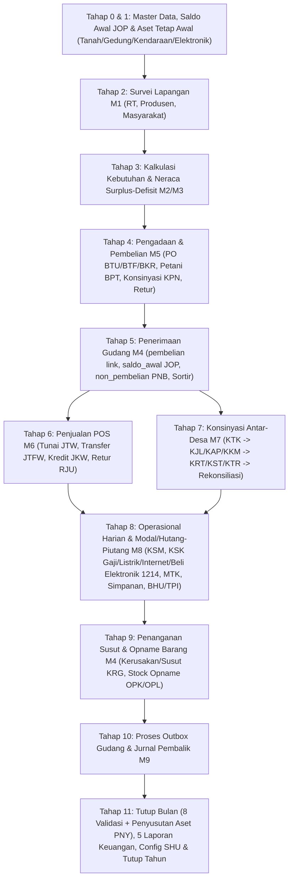

# Panduan Lengkap & Skenario Uji End-to-End (E2E) KDMP-V2 (Hulu ke Hilir)

Dokumen ini adalah panduan rinci langkah demi langkah untuk menguji **seluruh fitur dan skenario** di KDMP-V2 dari awal (**Master Data & Saldo Awal**) hingga akhir (**Tutup Bulan, 5 Laporan Keuangan, Pembagian SHU & Tutup Tahun**), termasuk penempatan **Aset Tetap (Tanah, Gedung, Kendaraan, Barang Elektronik/Peralatan)**, **Operasional Harian**, **Simpanan Anggota**, **Pelunasan Hutang/Piutang**, dan **4 Jenis Susut/Penyusutan**.

> [!IMPORTANT]
> Panduan ini disusun mengikuti kondisi kode aktual saat ini agar Anda dapat menguji seluruh modul secara end-to-end dengan lancar, termasuk alur **Aset Tetap (Tanah, Gedung, Kendaraan, Elektronik)**, **Operasional Harian**, **Kas & Bank (wajib No. Rekening untuk Bank)**, dan **Penyusutan (`PNY`) saat Tutup Bulan**.

---

## BAGIAN I: Persiapan Teknis, Akun Login Demo & Peta Fitur

### 1. Checklist Persiapan Terminal (Sebelum Uji di Browser)

1. **Migrasi Database Terbaru** (termasuk tabel `antrean_jurnal_gudang`):
   ```bash
   php artisan migrate
   ```
2. **Seeder Lengkap (Master, COA, Template Jurnal, Data Demo & Akun Peran):**
   Jalankan seeder utama (`DatabaseSeeder` akan menjalankan `CoaSeeder`, `TransaksiTemplateSeeder`, `PeranSeeder`, `DataAwalSeeder`, `M2PerencanaanSeeder`, `M3PerencanaanSeeder`, `KonsinyasiDemoSeeder`, dan `PerencanaanDemoSeeder`):
   ```bash
   php artisan db:seed
   ```
   *(Jika hanya butuh memperbarui template transaksi baru seperti `PNB`, `KRG`, `OPK`, `OPL`, `PNY`, jalankan `php artisan db:seed --class=TransaksiTemplateSeeder`.)*
3. **Pemrosesan Outbox Jurnal Gudang (`antrean_jurnal_gudang`):**
   - **Cara 1 (Tombol di UI — Paling Praktis Saat Demo):** Buka **Dasbor Alur & Demo ➔ Tab Alur ➔ Tahap 8**, lalu klik **`⚡ Proses Outbox Jurnal Gudang`**.
   - **Cara 2 (Manual via CLI):**
     ```bash
     php artisan jurnal:proses-gudang
     ```
   - **Cara 3 (Otomatis Background Worker):**
     ```bash
     php artisan queue:work
     ```
4. **Build Aset Frontend (Vite):**
   ```bash
   npm run build
   ```
   *(Di PowerShell Windows bila terblokir execution policy `npm.ps1`, gunakan `npm.cmd run build`.)*

---

### 2. Daftar Akun Login Demo (Password Semua Akun: `password`)

Seeder `DataAwalSeeder` membuat 2 koperasi desa contoh agar seluruh alur—termasuk **Konsinyasi Antar-Desa**—bisa diuji:
- **KDMP-A** (`Koperasi Desa Merah Putih Mekar Jaya`)
- **KDMP-B** (`Koperasi Desa Merah Putih Sukamaju`)

| Peran | Email Login (KDMP-A) | Email Login (KDMP-B) | Fokus Modul di Sidebar |
| :--- | :--- | :--- | :--- |
| **Super Admin** | `superadmin@ngobar.id` | *(lintas entitas)* | `Persetujuan Entitas`, semua modul (`Master ➔ Entitas`) |
| **Manajer** | `manajer@kdmp-a.test` | `manajer@kdmp-b.test` | `Master Data`, `Survei & Pemetaan`, `Kalkulasi & Perencanaan`, akses lintas operasional internal desa |
| **Surveyor** | `surveyor@kdmp-a.test` | `surveyor@kdmp-b.test` | `Survei & Pemetaan` (M1) |
| **Staf Pembelian** | `pembelian@kdmp-a.test` | `pembelian@kdmp-b.test` | `Pembelian & Penjualan ➔ Order Pembelian & Retur Pembelian` (M5) |
| **Admin Gudang** | `gudang@kdmp-a.test` | `gudang@kdmp-b.test` | `Manajemen Gudang` (M4) & `Konsinyasi & Titipan` (M7) |
| **Kasir (POS)** | `kasir@kdmp-a.test` | `kasir@kdmp-b.test` | `Pembelian & Penjualan ➔ Order & Retur Penjualan` (M6), `Kas & Transaksi` (M8) |
| **Akuntan** | `akuntan@kdmp-a.test` | `akuntan@kdmp-b.test` | `Buku Keuangan` (M8) & `Akuntansi & Laporan` (M9) |

> [!TIP]
> Setelah login (misal sebagai `manajer@kdmp-a.test` atau `superadmin@ngobar.id`), Anda bisa berpindah peran dengan cepat melalui switcher **Peran Demo** di halaman **Dasbor Alur & Demo** tanpa mengetik ulang email dan password.

---

### 3. Peta Alur Besar & Jawaban Cepat: "Fitur X Ditaruh di Tahap Mana?"



| Fitur / Skenario yang Ingin Diuji | Ditaruh di Tahap Mana? | Menu / Halaman di Aplikasi | Kode Jurnal & COA Terdampak |
| :--- | :--- | :--- | :--- |
| **Tanah, Gedung, Kendaraan, Elektronik/Peralatan yang SUDAH DIMILIKI sejak awal berdiri** | **Tahap 1 (1B & 1C)** | 1) `Akuntansi & Laporan ➔ Saldo Awal`<br>2) `Akuntansi & Laporan ➔ Aset Tetap` | `JOP`: (D) `1211` Tanah / `1212` Gedung / `1213` Kendaraan / `1214` Peralatan & Komputer vs (K) `311`/`321`/`322` |
| **Membeli Barang Elektronik / Peralatan / Kendaraan / Gedung BARU setelah koperasi berjalan** | **Tahap 8 (8C)** | 1) `Buku Keuangan ➔ Kas & Transaksi ➔ Kas Keluar`<br>2) `Akuntansi & Laporan ➔ Aset Tetap` | `KSK`: (D) `1214` Peralatan & Komputer *(atau `1212`/`1213`)* vs (K) `1111` Kas / `11121` Bank A |
| **Penyusutan / Penurunan Nilai Aset Tetap** *(Gedung, Kendaraan, Elektronik/Komputer; Tanah tidak disusutkan)* | **Tahap 11 (11A)** | `Akuntansi & Laporan ➔ Tutup Bulan` *(otomatis dijalankan saat Tutup Bulan)* | `PNY`: (D) `631`/`632`/`633` vs (K) `1222`/`1223`/`1224` *(Tanah otomatis Rp 0)* |
| **Operasional Harian** *(Gaji, Tunjangan, Listrik, Telepon & Internet, ATK, Air PAM, BBM/Transport, Konsumsi, Admin Bank, Rapat)* | **Tahap 8 (8B)** | `Buku Keuangan ➔ Kas & Transaksi ➔ Tambah ➔ Kas Keluar` | `KSK`: (D) `611`–`626`, `651`–`652` vs (K) `1111` Kas / `11121` Bank A |
| **Pemasukan Non-Penjualan** *(Jasa Timbang, Sewa Kios, Pendapatan Lain)* & **Mutasi Kas ke Bank** | **Tahap 8 (8A & 8D)** | `Buku Keuangan ➔ Kas & Transaksi` (`Kas Masuk` / `Mutasi Antar Kas`) | `KSM` `(D) Kas/Bank / (K) 711` • `MTK` `(D) Bank / (K) Kas` |
| **Simpanan Anggota** *(Pokok, Wajib, Sukarela)* | **Tahap 1 & 8 (8A)** | `Buku Keuangan ➔ Kas & Transaksi ➔ Kas Masuk` *(akun `311`, `312`, `2115`)* | `SPK` / `SWJ` / `SSK` *(atau via `KSM` ke `311`/`312`/`2115`)* |
| **Pelunasan Hutang Supplier (`BHU`) & Terima Piutang Warga (`TPI`)** | **Tahap 8 (8E)** | `Buku Keuangan ➔ Hutang` / `Piutang` / `Pelunasan` | `BHU` `(D) 2111 / (K) Kas/Bank` • `TPI` `(D) Kas/Bank / (K) 1132` |
| **Susut, Rusak, Hilang, atau Kadaluarsa Barang Dagang** *(misal Beras berkurang/busuk di gudang)* | **Tahap 9 (9A)** | `Manajemen Gudang ➔ Kerusakan` | `KRG` *(outbox)*: (D) `641 Biaya Kerusakan & Susut Persediaan` vs (K) `1123` Persediaan |
| **Selisih Hitung Rak Gudang** *(Kurang / Lebih)* | **Tahap 9 (9B)** | `Manajemen Gudang ➔ Stock Opname` | `OPK` `(D) 641 / (K) 1123` • `OPL` `(D) 1123 / (K) 712 Selisih Lebih` |
| **Susut Barang Titipan Konsinyasi** | **Tahap 7 (7B & Catatan 7F)** | `Konsinyasi & Titipan ➔ Pengiriman` *(pilih Penanggung Susut)* & `Stok Konsinyasi` | `KSP` `(D) 641 / (K) 1126` *(beban pemilik)* • `KSN` `(D) 641 / (K) 2117` *(beban penerima)* |
| **Barang Rusak Saat Bongkar dari Supplier** | **Tahap 5 (5A)** & **Tahap 4 (4E)** | `Manajemen Gudang ➔ Penerimaan` *(isi Qty Layak)* + `Retur Pembelian` | Stok gudang hanya bertambah sesuai Qty Layak; Retur supplier memotong kas (`RBU`) atau hutang (`RBH`) |

---

## BAGIAN II: Skenario Pengujian End-to-End Lengkap (Dengan Angka Terrekonsiliasi)

> [!TIP]
> Agar seluruh angka **Neraca Saldo, Laba Rugi, Neraca, Arus Kas, Posisi Stok, dan Sub-Ledger Hutang/Piutang** bisa langsung Anda cocokkan sampai **selisih Rp 0**, gunakan angka contoh di bawah ini secara berurutan pada entitas **`KDMP-A`**.
> **Penting untuk uji `Tutup Bulan`:** Tombol eksekusi Tutup Bulan di UI hanya aktif untuk bulan yang **sudah lewat** *(lihat catatan teknis di Tahap 11A)*. Jika ingin menguji sampai tombol **Tutup Periode** di bulan yang sudah berakhir (misal bulan lalu), konsistenkan seluruh tanggal transaksi uji di bulan lalu tersebut; jika hanya ingin mengecek **8 validasi** dan **5 laporan** pada bulan berjalan, gunakan tanggal hari ini.

---

### TAHAP 0 & 1: Setup Multi-Tenant, Master Data, Saldo Awal (`JOP`) & Aset Tetap Awal

#### Langkah 0 — (Opsional) Uji Pendaftaran Koperasi Baru & Approval Super Admin
Jika ingin mengetes alur multi-tenant dari nol:
1. Buka `/register` (tanpa login), daftarkan koperasi baru & akun manajer pertamanya.
2. Login sebagai **`superadmin@ngobar.id`** (`password`), masuk menu **Super Admin ➔ Persetujuan Entitas** (`/admin/dashboard`), lalu klik **Approve**.
   - **Data Otomatis Entitas Baru (`EntitasController::provisionDefaultMasterData()`):** Begitu di-Approve (atau dibuat melalui `Master Data ➔ Entitas`), sistem otomatis mengisi: `Gudang Utama` (`UTAMA`), `Kas Utama` (`1111`) & `Bank A` (`11121`), `Periode Akuntansi` bulan `1–13 OPEN`, relasi pihak `entitas_lain` antardesa, **7 Satuan Ukur dasar** (`KG`, `KARUNG`, `LTR`, `UNIT`, `PCS`, `BOX`, `BUTIR`), serta **7 Komoditas pokok** (`Beras`, `Jagung`, `Gula Pasir`, `Minyak Goreng`, `Telur Ayam`, `Daging Sapi`, `Cabai Merah`) — **tanpa membuat data `Master Barang`** agar tiap koperasi mengisi daftar barangnya sendiri.
3. Login kembali menggunakan akun baru (atau lanjutkan seluruh skenario berikut memakai entitas demo **`KDMP-A`** yang sudah dilengkapi barang contoh, mitra lokal, dan data konsinyasi `KDMP-B`).

#### Langkah 1A — Verifikasi & Lengkapi Master Data (`manajer@kdmp-a.test`)
Masuk ke kelompok menu **Master Data**:
1. **Komoditas** & **Satuan Ukur**: Baik pada `KDMP-A` maupun entitas baru hasil approval/pembuatan Super Admin, komoditas pokok (`Beras`, `Gula Pasir`, `Minyak Goreng`, `Telur Ayam`, `Daging Sapi`, `Jagung`, `Cabai Merah`) dan satuan dasar (`KG`, `KARUNG`, `LTR`, `UNIT`, `PCS`, `BOX`, `BUTIR`) **sudah otomatis tersedia**. Tambahkan manual hanya bila perlu satuan/komoditas ekstra.
2. **Barang** (`Master Data ➔ Barang`):
   - *(Jika menggunakan `KDMP-A`)*: Periksa barang **`Beras Medium` (`BRG-BERAS-MEDIUM`)**: Unit Usaha `Sembako` *(COA: Persediaan `1123`, Pendapatan Anggota `411`, Non-Anggota `412`, HPP `511`)*, Satuan Dasar `KG`, konversi `1 KARUNG = 25 KG`, pastikan `is_dijual = aktif` dan isi **Harga Jual Standar = `Rp 16.000`** agar muncul di Kasir POS.
   - *(Jika menggunakan akun/entitas baru)*: Daftar **Barang** sengaja dimulai kosong—klik **`+ Tambah Barang`** untuk membuat barang baru (opsi **Komoditas**, **Satuan Dasar**, dan **Unit Usaha** sudah siap dipilih).
   - Uji **Stok Minimum**: klik rute stok minimum barang untuk menetapkan ambang stok aman (misal `100 kg`).
   - *(Opsional untuk uji Batch & Kedaluwarsa)*: aktifkan pelacakan batch/kedaluwarsa pada barang contoh agar panel **Rincian Batch & Kedaluwarsa** muncul di Gudang.
3. **Pihak/Mitra** (`Master Data ➔ Pihak/Mitra`): Untuk entitas baru, relasi `entitas_lain` dengan koperasi mitra sudah terbuat otomatis; untuk uji lokal pastikan juga ada *(atau tambahkan pada akun baru)*:
   - Warga Anggota (`Warga Contoh`, `jenis_pihak = warga`, `is_anggota = ya`)
   - Supplier (`Toko Sembako Sumber Rejeki`, `jenis_pihak = supplier`)
   - Petani Lokal (`Petani Lokal` bila ingin menguji jalur cepat `BPT`)
   - Desa Mitra (`Koperasi Desa Merah Putih Sukamaju` / `KDMP-B`, `jenis_pihak = entitas_lain`)
4. **Gudang** (`Master Data ➔ Gudang`): Pastikan **`Gudang Koperasi Desa Mekar Jaya` (`UTAMA`)** aktif.
5. **Kas & Bank** (`Master Data ➔ Kas & Bank`):
   - Pastikan **`Kas Utama`** (`jenis = kas`, `kode_akun = 1111`) aktif.
   - Buka/edit **`Bank A`** (`jenis = bank`, `kode_akun = 11121`) dan **WAJIB pastikan kolom `No. Rekening` terisi** (misal `123-456-7890`).
     > *(Memang disengaja oleh sistem: `PenjualanController::create()`, `PenjualanService`, `PelunasanController::create()`, dan `StorePelunasanRequest` mewajibkan akun berjenis `bank` memiliki `no_rekening` agar transaksi transfer jelas tujuannya. Seeder `DataAwalSeeder` sengaja mengosongkan `no_rekening` supaya tiap koperasi mengisi nomor rekening aslinya; jika belum diisi, bank tersebut tidak akan muncul di pilihan Transfer POS & Pelunasan.)*
6. **Periode Akuntansi** (`Master Data ➔ Periode Akuntansi`) & **Chart of Accounts** (`Master Data ➔ Chart of Accounts`): Pastikan tahun buku `2026` bulan `1` sampai `13` berstatus **`OPEN`**.

#### Langkah 1B — Input Saldo Awal Neraca Pembuka: Modal Kas + Persediaan Awal + Tanah, Gedung, Kendaraan & Peralatan Awal (`akuntan@kdmp-a.test`)
Masuk menu **Akuntansi & Laporan ➔ Saldo Awal** (`/akuntansi/saldo-awal`):
> **Catatan Konsep:** Fitur Pembelian (`Order Pembelian`) mewajibkan koperasi memiliki **Saldo Awal Kas (`JOP`)** atau **Simpanan Pokok (`SPK`)** sebelum boleh membuat PO. Di sinilah modal awal **sekaligus seluruh aset tetap awal (Tanah, Gedung, Kendaraan, Peralatan awal)** dan **nilai rupiah stok gudang awal** dicatat!

Isi baris **Sisi Debet (Aset)** dan **Sisi Kredit (Modal)** persis seperti tabel berikut:

| Sisi | Kode & Nama Akun COA | Keterangan Skenario | Nilai (Rp) |
| :--- | :--- | :--- | ---: |
| **DEBET** | `1111` — Kas | Kas tunai awal di laci kasir & brankas | `40.000.000` |
| **DEBET** | `11121` — Bank A | Saldo awal rekening bank koperasi | `20.000.000` |
| **DEBET** | `1123` — Persediaan Barang Jadi - Sembako | Nilai 200 kg Beras Medium @ Rp 10.000 yang sudah ada di gudang sebelum sistem dipakai *(fisiknya diinput di Tahap 5B sumber `saldo_awal`!)* | `2.000.000` |
| **DEBET** | `1211` — Tanah | Lahan milik koperasi 200 m² *(nilai awal)* | `100.000.000` |
| **DEBET** | `1212` — Gedung & Bangunan | Bangunan toko & gudang awal | `60.000.000` |
| **DEBET** | `1213` — Kendaraan | Motor roda tiga angkut barang awal | `18.000.000` |
| **DEBET** | `1214` — Peralatan & Komputer | Rak gudang & meja kasir awal | `7.000.000` |
| **KREDIT** | `311` — Simpanan Pokok | Setoran simpanan pokok awal anggota | `27.000.000` |
| **KREDIT** | `321` — Modal Penyertaan | Modal penyertaan dari desa / BUMDes | `120.000.000` |
| **KREDIT** | `322` — Modal Hibah / Bantuan Pemerintah | Bantuan aset lahan/bangunan awal | `100.000.000` |

- Pastikan **Total Debet = Total Kredit = `Rp 247.000.000`** (`Selisih Rp 0`), lalu klik **Simpan**.
- Cek **Akuntansi & Laporan ➔ Jurnal**: pastikan jurnal bertipe `JOP` terposting, dan cek **Buku Keuangan ➔ Kas & Transaksi** / **Neraca**.

#### Langkah 1C — Daftarkan Kartu Aset Tetap Awal ke Sub-Modul Penyusutan (`akuntan@kdmp-a.test`)
Masuk menu **Akuntansi & Laporan ➔ Aset Tetap ➔ + Tambah Aset Baru**:
> **Mengapa harus diisi di `Aset Tetap` juga?** Karena `Saldo Awal (JOP)` baru mencatat saldo Rupiah di Neraca, sedangkan daftar **`Aset Tetap`** menyimpan **umur ekonomis (bulan)** dan **akun beban/akumulasi** untuk menghitung penyusutan otomatis per bulan saat **Tutup Bulan**.

Siapkan/daftarkan 4 kartu aset tetap awal berikut:

| Kode Aset | Nama Aset | Kategori | Nilai Perolehan | Nilai Residu | Umur (Bulan) | Akun Aset | Akun Akumulasi | Akun Biaya Penyusutan | Susut / Bulan (Garis Lurus) |
| :--- | :--- | :--- | ---: | ---: | ---: | :---: | :---: | :---: | ---: |
| `AST-TNH-01` | Tanah Lahan Koperasi 200 m² | `tanah` | `100.000.000` | `100.000.000` | `0` *(tidak susut)* | `1211` Tanah | — | — | `Rp 0` |
| `AST-GDG-01` | Gedung Toko & Gudang Utama | `gedung` | `60.000.000` | `12.000.000` | `240` | `1212` | `1222` | `631` Biaya Penyusutan Gedung | `Rp 200.000` |
| `AST-KND-01` | Motor Roda Tiga Angkut Barang | `kendaraan` | `18.000.000` | `3.600.000` | `48` | `1213` | `1223` | `632` Biaya Penyusutan Kendaraan | `Rp 300.000` |
| `AST-PRL-01` | Rak Gudang & Meja Kasir Awal | `peralatan` | `7.000.000` | `700.000` | `36` | `1214` | `1224` | `633` Biaya Penyusutan Peralatan | `Rp 175.000` |

> [!NOTE]
> **Aturan Form Aset Tetap & Penyusutan Saat Ini:**
> - **Anti-Dobel Jurnal:** Menyimpan/mengubah kartu di `Aset Tetap` (`AsetTetapController::store()`) **TIDAK membentuk jurnal perolehan aset (`1211–1214`) lagi**—nilai perolehan aset hanya terjurnal 1 kali dari **Saldo Awal (`JOP`)** di Langkah 1B atau **Kas Keluar (`KSK`)** di Tahap 8C. Satu-satunya jurnal dari tabel `aset_tetap` adalah beban penyusutan bulanan (`PNY`: Debet `631–633` / Kredit `1222–1224`) saat Tutup Bulan.
> - Kategori menggunakan dropdown baku: `peralatan` (`1214`), `kendaraan` (`1213`), `gedung` (`1212`), dan `tanah` (`1211`).
> - Khusus jika memilih **`tanah`**, form otomatis mengunci `Umur Ekonomis = 0` dan mengosongkan akun akumulasi/biaya penyusutan karena **Tanah tidak disusutkan** (juga otomatis dilewati oleh `TutupBulanService`).
> - Dropdown **Akun Aset** menyaring COA `121x`, **Akun Akumulasi** menyaring `122x`, dan **Akun Biaya Penyusutan** memprioritaskan `631–633` (diikuti akun biaya `6xx` aktif lainnya).

---

### TAHAP 2: Survei Lapangan & Pemetaan Konsumsi/Produksi Desa (`surveyor@kdmp-a.test`, Modul Survei M1)

> **Tujuan:** Mengumpulkan data primer kebutuhan konsumsi warga dan potensi panen lokal, lalu memvalidasi & menyinkronkannya ke modul Kalkulasi Perencanaan. *(Tahap ini belum menghasilkan jurnal akuntansi.)*

1. Masuk menu **Survei & Pemetaan ➔ Sesi Survei**:
   - Klik tambah sesi survei baru (pilih periode/bulan target), lalu simpan.
   - Di detail sesi (`show`), salin link/token survei publik untuk diuji di tab browser lain *(tanpa perlu login)*:
     - **Survei RT:** `/survei/isi/rt/{token}`
     - **Survei Produsen:** `/survei/isi/produsen/{token}`
     - **Survei Masyarakat (Multi-Step):** `/survei/isi/masyarakat/{token}` *(Step 1 Biodata & GPS ➔ Step 2 Anggota KK ➔ Step 3 Konsumsi Keluarga + Voice/STT ➔ Step 4 Review & Submit)*
     - **Survei Sesi 1–4:** `/survei/isi/{token}/sesi1` s/d `sesi4`
2. Buka **Survei & Pemetaan ➔ Data RT**: tambah/cek kuota baseline KK tiap RT (misal RT 01 = 30 KK).
3. Buka **Survei & Pemetaan ➔ Produsen Desa**: input kelompok tani desa dengan potensi panen bulanan (misal Komoditas Beras = estimasi `500 kg/bulan`).
4. Buka **Survei & Pemetaan ➔ Validasi Survei**: periksa baseline vs realisasi pengisian warga, setujui isian responden.
5. Kembali ke **Sesi Survei**, tekan tombol **Sinkron** (`survei.sesi.sinkron`) agar data survei masuk ke tabel parameter M2 Perencanaan, lalu cek ringkasannya di **Dashboard Survei** & **Bank Pertanyaan**.

---

### TAHAP 3: Kalkulasi Kebutuhan, Neraca Surplus-Defisit & Rencana Pengadaan (`manajer@kdmp-a.test`, Modul M2/M3)

> **Tujuan:** Mengkalkulasi kebutuhan pangan desa, memetakan status **SURPLUS / DEFISIT**, membandingkan harga antar-desa/pemasok, dan menerbitkan **Permintaan Pengadaan (PR)** resmi. *(Tahap ini juga belum menghasilkan jurnal akuntansi.)*

1. Buka **Kalkulasi & Perencanaan ➔ Data & Parameter** (`Demografi`, `Potensi Produksi`, `Standar Kebutuhan`): verifikasi data hasil sinkronisasi survei (jumlah penduduk, konsumsi per kapita, hasil panen lokal).
2. Buka **Kalkulasi & Perencanaan ➔ Kalkulasi Kebutuhan**: pilih periode dan klik tombol **Kalkulasi** untuk menghasilkan *snapshot* total kebutuhan bulanan komoditas (misal kebutuhan Beras desa = `1.200 kg`).
3. Buka **Kalkulasi & Perencanaan ➔ Surplus Defisit** *(Neraca Komoditas)*:
   - Sistem membandingkan `Produksi Lokal (500 kg) - Kebutuhan (1.200 kg) = -700 kg` ➔ Status **`DEFISIT`**.
   - Untuk komoditas lain yang produksinya > kebutuhan ➔ Status **`SURPLUS`** *(siap dikonsinyasikan ke desa mitra di Tahap 7)*.
   - Cek juga **Laporan Kalkulasi**.
4. Buka **Kalkulasi & Perencanaan ➔ Perbandingan Harga**: bandingkan harga penawaran supplier lokal vs koperasi desa mitra (`KDMP-B`) untuk komoditas Beras.
5. Buka **Kalkulasi & Perencanaan ➔ Permintaan Pengadaan** *(atau klik tombol Ajukan/Buat Permintaan dari hasil Neraca)*:
   - Buat Permintaan Pengadaan (PR) untuk `Beras Medium` sebesar **`500 kg`**, pilih gudang tujuan `Gudang Koperasi Desa Mekar Jaya`.
   - Ubah status/setujui PR menjadi **`disetujui`** agar dapat dipilih saat membuat Order Pembelian (PO).

---

### TAHAP 4: Pengadaan, Order Pembelian (PO) & Retur Pembelian (`pembelian@kdmp-a.test`, Modul Pembelian M5)

Masuk menu **Pembelian & Penjualan ➔ Order Pembelian** (`/pembelian/pembelian`):

#### Skenario 4A — Pembelian Tunai dari PR (`BTU`)
1. Klik **Tambah / Buat Pembelian**. Di kotak **Notifikasi Kebutuhan Gudang**, pilih PR yang sudah disetujui (atau pilih sumber manual `Pembelian dari Warga Lokal`), pilih supplier `Toko Sembako Sumber Rejeki`.
2. Masukkan item **`Beras Medium`**, Qty **`500 KG`**, Harga per KG **`Rp 10.000`** (Total **`Rp 5.000.000`**).
3. Jenis Pembayaran: **`Tunai`**, Sumber Uang: **`Kas Utama (1111)`**. Klik **Lanjutkan** (status `draft`).
4. Pada halaman detail PO, klik **`✓ Setujui`**:
   - **Efek Jurnal Otomatis (`BTU`):** `(D) 1123 Persediaan Sembako Rp 5.000.000` / `(K) 1111 Kas Utama Rp 5.000.000`.
   - Coba klik **Lihat / Cetak Invoice** untuk memverifikasi faktur pembelian.

#### Skenario 4B — Pembelian Kredit / Tempo ke Supplier (`BKR`)
1. Buat PO baru untuk supplier `Toko Sembako Sumber Rejeki`: item **`Beras Medium`**, Qty **`300 KG`**, Harga **`Rp 10.000/kg`** (Total **`Rp 3.000.000`**).
2. Jenis Pembayaran: **`Kredit`**, isi **Tanggal Jatuh Tempo** (misal 30 hari lagi).
3. Simpan lalu klik **`✓ Setujui`**:
   - **Efek Jurnal Otomatis (`BKR`):** `(D) 1123 Persediaan Sembako Rp 3.000.000` / `(K) 2111 Hutang Dagang Rp 3.000.000`.
   - **Efek Sub-Ledger:** Otomatis tercatat tagihan hutang baru di menu **Buku Keuangan ➔ Hutang**.

#### Skenario 4C & 4D — Jalur Lain Pembelian (Opsional Cek)
- **Transfer Bank (`BTF`)**: Sama seperti 4A tetapi pilih `Jenis Pembayaran = Transfer` dan rekening `Bank A (11121)`.
- **Beli dari Petani Lokal (`BPT`)** / **Pengambilan Konsinyasi (`KPN`)**: Pada form PO baru, pilih sumber `Pengambilan Konsinyasi` dari desa mitra `KDMP-B` — otomatis dikunci sebagai kredit ke akun `2117 Hutang Konsinyasi` tanpa memilih kas/bank.

#### Skenario 4E — Retur Pembelian Potong Hutang (`RBH`) / Diganti Uang (`RBU`)
Masuk menu **Pembelian & Penjualan ➔ Retur Pembelian** (`/pembelian/retur`):
1. Ajukan retur terhadap **PO Kredit (4B)** sebanyak **`20 KG`** Beras (nilai **`Rp 200.000`**) dengan alasan kemasan rusak/tidak layak, jenis penyelesaian **`Potong Hutang`**.
2. Setujui retur (`approve`):
   - **Efek Jurnal (`RBH`):** `(D) 2111 Hutang Dagang Rp 200.000` / `(K) 1123 Persediaan Sembako Rp 200.000`.
   - Sisa hutang pada PO 4B otomatis turun dari `Rp 3.000.000` menjadi **`Rp 2.800.000`**.

> [!TIP]
> **Kapan membuat Retur Pembelian?** Jika saat membongkar barang di Gudang (Tahap 5A) ada barang yang disortir **Tidak Layak** dari PO yang sudah disetujui, buatlah Retur Pembelian untuk qty tidak layak tersebut agar nilai **Persediaan di Buku Besar (`1123`) tetap cocok dengan nilai stok fisik layak di Gudang** (syarat lulus Validasi #4 Tutup Bulan!).

---

### TAHAP 5: Penerimaan Fisik Gudang (GRN) dengan 3 Sumber & Anti-Dobel Jurnal (`gudang@kdmp-a.test`, Modul Gudang M4)

Masuk menu **Manajemen Gudang ➔ Penerimaan ➔ Tambah** (`/gudang/penerimaan/create`):

#### Skenario 5A — Sumber `pembelian` (PO Disetujui — Tautkan Jurnal Pembelian)
1. **Sumber Penerimaan**: Pilih **`Dari Pembelian (PO Disetujui - Tautkan Jurnal Pembelian)`**.
2. Terima PO Tunai (4A): Pilih **`PO 4A`** di kolom *Referensi Pembelian (PO Disetujui)*. Item dan harga otomatis terisi (`500 KG` @ `Rp 10.000`; bisa uji terima pakai satuan `20 KARUNG` dengan faktor konversi `25 = 500 KG`). Isi `Jumlah Layak = 500` dan lengkapi rincian batch/kedaluwarsa bila barang memakai pelacakan batch. Simpan.
3. Terima PO Kredit (4B) **dan uji Sortir Kelayakan**: Pilih **`PO 4B`** (`300 KG`). Karena di 4E tadi ada `20 KG` yang diretur/tidak layak, masukkan **`Jumlah Layak = 280`**, sehingga kolom **Tidak Layak** otomatis menampilkan **`20 KG`**, lalu isi **Alasan Tidak Layak**: `"20 kg karung robek saat bongkar, dikembalikan ke supplier"`. Simpan!
   - **Verifikasi Anti-Dobel Jurnal:** Buka detail dokumen GRN tersebut; sistem menampilkan tautan ke **ID Jurnal Pembelian (4A/4B)** sehingga **TIDAK ada jurnal persediaan ganda** yang dibuat.

#### Skenario 5B — Sumber `saldo_awal` (Stok Awal / Migrasi — Tautkan Jurnal `JOP`)
> Untuk memunculkan stok fisik gudang **200 kg** Beras Medium yang saldo Rupiahnya (`Rp 2.000.000`) sudah dicatat di **Tahap 1B (`JOP`)**:
1. Buat Penerimaan baru, pilih **Sumber Penerimaan**: **`Stok Awal / Migrasi (Tautkan Jurnal Saldo Awal JOP)`**.
2. Gudang: `Gudang Koperasi Desa Mekar Jaya`, Pihak: pilih pihak default/internal, Barang: **`Beras Medium`**, Qty **`200`**, Satuan `KG`, Harga **`10.000`**, Jumlah Layak **`200`**. Klik **Simpan Penerimaan**.
   - **Hasil:** Stok gudang bertambah **`+200 KG`**, namun **TIDAK membuat jurnal `PNB` atau pembelian baru** karena ditautkan langsung ke `JOP` dari Tahap 1B!

#### Skenario 5C — Sumber `non_pembelian` (Hibah / Terima Lainnya — Buat Jurnal `PNB`)
> Untuk barang masuk baru setelah berjalan yang **bukan pembelian** dan **bukan saldo awal** (misal bantuan/hibah pangan):
1. Buat Penerimaan baru, pilih **Sumber Penerimaan**: **`Non-Pembelian (Hibah / Terima Lainnya - Buat Jurnal PNB)`**.
2. Barang: **`Beras Medium`**, Qty **`100`**, Satuan `KG`, Harga **`10.000`** (Total **`Rp 1.000.000`**), Jumlah Layak **`100`**, Catatan: `"Hibah bantuan cadangan pangan desa"`. Klik **Simpan Penerimaan**.
   - **Hasil:** Stok gudang bertambah **`+100 KG`** dan masuk ke tabel antrean `antrean_jurnal_gudang` berstatus `MENUNGGU` untuk dijadikan jurnal **`PNB`** (`(D) 1123 Persediaan / (K) 711 Pendapatan Lain-lain`) pada Tahap 10.

#### Cek Saldo Sementara Gudang setelah Tahap 5:
Buka **Manajemen Gudang ➔ Posisi Stok**, **Batch & Kedaluwarsa**, dan **Kartu Stok**:
- Total fisik masuk bersih = `500 (4A) + 280 (4B layak) + 200 (5B) + 100 (5C)` = **`1.080 KG`** (`Rp 10.800.000`, HPP rata-rata bergerak = **`Rp 10.000/kg`**).

---

### TAHAP 6: Penjualan Kasir / POS & Retur Penjualan (`kasir@kdmp-a.test`, Modul Penjualan M6)

Masuk menu **Pembelian & Penjualan ➔ Order Penjualan** (`/penjualan/penjualan`) lalu masuk ke layar **Kasir / POS** (`create`):
> Pada unit usaha pilih **`Sembako`**. Gunakan barang **`Beras Medium`** (`harga jual Rp 16.000/kg`).

#### Skenario 6A — Penjualan Tunai (`JTW`)
1. Masukkan `Beras Medium` sebanyak **`500 KG`** (Total **`Rp 8.000.000`**). Nama Pembeli: `Warga Anggota Budi`.
2. Metode Pembayaran: **`💵 Tunai (Cash)`**, tekan **`F4`** (Uang Pas) atau ketik `8.000.000`, lalu klik **Proses Pembayaran / Simpan**.
3. **Efek Otomatis (`JTW`):** Terbentuk **4 baris jurnal**:
   - `(D) 1111 Kas Utama Rp 8.000.000` | `(K) 411/412 Penjualan Sembako Rp 8.000.000`
   - `(D) 511 HPP Sembako Rp 5.000.000` | `(K) 1123 Persediaan Sembako Rp 5.000.000`

#### Skenario 6B — Penjualan Transfer / Bank (`JTFW`)
1. Masukkan `Beras Medium` sebanyak **`100 KG`** (Total **`Rp 1.600.000`**). Nama Pembeli: `Ibu Siti`.
2. Metode Pembayaran: **`💳 Transfer / Bank`** *(aktif karena `Bank A` sudah punya No. Rekening!)*.
3. Pilih Rekening Tujuan **`Bank A`**, isi Nama Pengirim, Bank Pengirim, No. Rekening Pengirim, Nomor Referensi Transfer, dan **centang konfirmasi dana transfer sudah masuk**. Simpan.
4. **Efek Otomatis (`JTFW`):** Kas bertambah di **`11121 Bank A`** (`Rp 1.600.000`), Pendapatan +`1.600.000`, HPP +`1.000.000`, Persediaan -`1.000.000`.

#### Skenario 6C — Penjualan Kredit / Kasbon (`JKW`)
1. Masukkan `Beras Medium` sebanyak **`50 KG`** (Total **`Rp 800.000`**). Nama Pembeli: `Pak Ahmad`.
2. Metode Pembayaran: **`🧾 Kredit`**, isi **Tanggal Jatuh Tempo** (minimal hari ini / ke depan). Simpan.
3. **Efek Otomatis (`JKW`):** Terbentuk jurnal `(D) 1132 Piutang Dagang Rp 800.000` (+ sisi HPP `500.000`), dan tagihan piutang otomatis muncul di menu **Buku Keuangan ➔ Piutang**.

#### Skenario 6D — Retur Penjualan (`RJU`)
Masuk menu **Pembelian & Penjualan ➔ Retur Penjualan** (`/penjualan/retur/create`):
1. Pilih nomor nota dari **Penjualan Tunai (6A)**, Jenis Penyelesaian: **`Diganti Uang (Pengembalian Tunai/Transfer)`**, Alasan: `"Beras menggumpal"`, Qty Retur: **`10 KG`** (nilai **`Rp 160.000`**, HPP **`Rp 100.000`**).
2. Simpan / selesaikan retur:
   - **Efek Jurnal (`RJU`):** `(D) 421 Retur Penjualan Rp 160.000` / `(K) 1111 Kas Utama Rp 160.000` **serta** `(D) 1123 Persediaan Rp 100.000` / `(K) 511 HPP Rp 100.000` *(selalu pakai akun kontra `421` bukan mendebet `411/412` langsung)*.

---

### TAHAP 7: Konsinyasi Antar-Desa & Susut Konsinyasi (`gudang@kdmp-a.test` & `KDMP-B`, Modul M7)

Masuk kelompok menu **Konsinyasi & Titipan** (atau mulai dari **Manajemen Gudang ➔ Pencocokan Surplus-Defisit**):

1. **7A. Pencocokan Surplus-Defisit:** Lihat daftar desa yang membutuhkan komoditas surplus dari desa pengirim.
2. **7B. Buat & Posting Pengiriman Konsinyasi (`Konsinyasi & Titipan ➔ Pengiriman ➔ Tambah`):**
   - Jenis Penitipan: **`Desa ke desa`** *(tersedia juga opsi **`Orang ke desa`** untuk titipan warga/petani perorangan tanpa mutasi stok normal pemilik)*.
   - Desa Pemilik: **`KDMP-A`**, Gudang Asal: `Gudang Koperasi Desa Mekar Jaya`.
   - Desa Penerima: **`KDMP-B`**, Gudang Tujuan: `Gudang Koperasi Desa Sukamaju`.
   - Model Imbalan: pilih **`Selisih harga`** (atau **`Komisi persen`** dan isi `Persen Komisi`), serta pilih **Penanggung Susut**: **`Pemilik`** (`KSP`) atau **`Penerima`** (`KSN`).
   - Tambah item: **`Beras Medium`**, Qty **`100 KG`**, Harga Titip `Rp 10.000`, Harga Jual Saran `Rp 12.000`. Simpan, lalu klik tombol **Posting Kiriman**!
   - **Efek Jurnal (`KTK` di pembukuan `KDMP-A`):** Reklasifikasi aset `(D) 1126 Persediaan Konsinyasi (Dititipkan) Rp 1.000.000` / `(K) 1123 Persediaan Sembako Rp 1.000.000`.
3. **7C. Cek Stok Konsinyasi di Desa Penerima (`gudang@kdmp-b.test`):**
   - Login/switch ke **`KDMP-B`**, buka **Konsinyasi & Titipan ➔ Stok Konsinyasi** untuk melihat detail stok titipan masuk (`Dititipkan = Terjual + Diretur + Susut + Sisa`).
   - Jika barang titipan dijual di `KDMP-B` lewat skema konsinyasi, sistem mencatat **`KJL`** di buku penerima (`Kas` D / `2117 Hutang Konsinyasi` K / `417 Pendapatan Imbalan Konsinyasi` K) dan **`KAP`** (+ **`KKM`** jika komisi persen) serentak di buku pemilik `KDMP-A`.
4. **7D. Retur Konsinyasi (`KRT`):** Jika ada titipan sisa yang tidak terjual dan dikembalikan ke pemilik, uji di **Konsinyasi & Titipan ➔ Retur Konsinyasi ➔ Tambah** *(di `KDMP-A` mengembalikan `1123` Debet / `1126` Kredit)*.
5. **7E. Setoran Hasil (`KST`/`KTR`) & Rekonsiliasi:** Catat setoran di **Konsinyasi & Titipan ➔ Setoran**, lalu buka **Konsinyasi & Titipan ➔ Rekonsiliasi** (`v_rekonsiliasi_konsinyasi`) dan pastikan **daftar selisih kosong** (syarat lulus Validasi #8 Tutup Bulan!).
6. **7F. Catatan mengenai Susut Konsinyasi (`KSP` / `KSN`):**
   - Pada form pengiriman konsinyasi sudah ada pilihan `Penanggung Susut` (`pemilik` ➔ template `KSP` `(D) 641 / (K) 1126`; `penerima` ➔ template `KSN` `(D) 641 / (K) 2117`), dan halaman detail `Stok Konsinyasi` sudah menyediakan kolom **`Susut`** beserta riwayat mutasi `SUSUT`. Namun kontrolernya saat ini bertipe *read-only* (`StokKonsinyasiController`), sehingga belum ada form input susut konsinyasi di UI—untuk menguji input susut barang via UI secara penuh, gunakan **Tahap 9A (`Manajemen Gudang ➔ Kerusakan`)**.

---

### TAHAP 8: Operasional Harian, Belanja Elektronik/Aset Baru, Simpanan Anggota & Pelunasan (`akuntan@kdmp-a.test`, Modul Keuangan M8)

> **Di sinilah seluruh transaksi operasional non-dagang, pembayaran biaya rutin, pembelian barang elektronik/peralatan baru, mutasi kas/bank, dan pelunasan hutang-piutang dicatat!**

#### 8A. Simpanan Anggota & Pemasukan Operasional Lain (`Kas & Transaksi ➔ Tambah ➔ Kas Masuk`)
Masuk menu **Buku Keuangan ➔ Kas & Transaksi ➔ Tambah**:
1. **Setoran Simpanan Pokok Anggota Baru:**
   - Jenis: **`Kas Masuk`**, Rekening: **`Kas Utama (1111)`**
   - Akun Sumber: **`311 - Simpanan Pokok`** *(bisa juga uji `312 - Simpanan Wajib` atau `2115 - Simpanan Sukarela Anggota`)*
   - Nilai: **`1.000.000`**, Keterangan: `"Setoran simpanan pokok 2 anggota baru"` ➔ Simpan.
2. **Pemasukan Operasional Lain (`KSM`):**
   - Jenis: **`Kas Masuk`**, Rekening: **`Kas Utama (1111)`**
   - Akun Sumber: **`711 - Pendapatan Lain-lain`**
   - Nilai: **`500.000`**, Keterangan: `"Pendapatan jasa timbang & sewa lapak halaman"` ➔ Simpan.

#### 8B. Pengeluaran Biaya Operasional Harian (`Kas & Transaksi ➔ Tambah ➔ Kas Keluar`, kode `KSK`)
Uji pengeluaran rutin operasional koperasi satu per satu di **Buku Keuangan ➔ Kas & Transaksi ➔ Tambah** dengan memilih jenis **`Kas Keluar`**:

| No | Skenario Operasional | Rekening Kas/Bank | Akun Tujuan (COA Biaya) | Nilai (Rp) | Keterangan Contoh |
| :---: | :--- | :--- | :--- | ---: | :--- |
| 1 | **Gaji Staf & Pengelola** | `Bank A (11121)` | `611` — Gaji | `3.000.000` | Transfer gaji kasir & admin gudang bulan ini |
| 2 | **Listrik Toko & Gudang** | `Kas Utama (1111)` | `623` — Listrik | `450.000` | Bayar token/tagihan listrik toko & gudang |
| 3 | **Telepon & Internet POS** | `Kas Utama (1111)` | `622` — Telepon & Internet | `300.000` | Tagihan WiFi kasir & operasional |
| 4 | **BBM & Transportasi** | `Kas Utama (1111)` | `625` — Bahan Bakar & Transport | `250.000` | BBM motor angkut & biaya pengiriman |
| 5 | **ATK & Biaya Kantor** | `Kas Utama (1111)` | `621` — Biaya Kantor | `150.000` | Beli kertas struk kasir, pulpen & map |
| *(opsional)* | Tunjangan / Air PAM / Konsumsi / Admin Bank / Rapat | Kas / Bank A | `612` / `624` / `626` / `651` / `652` | *(bebas)* | Biaya tunjangan, PAM, rapat anggota, admin bank |

*(Total pengeluaran biaya operasional dari 5 transaksi utama di atas = **`Rp 4.150.000`**.)*

#### 8C. Beli Barang Elektronik / Peralatan Baru Saat Koperasi Berjalan (2 Langkah!)
> **Penting:** Pembelian barang modal seperti **Laptop Kasir, Timbangan Digital Elektronik, Kulkas Pendingin, AC, Printer Struk, Kendaraan Baru, atau Biaya Bangun/Renovasi Gedung** **TIDAK** diinput di modul `Pembelian Barang Dagang` (yang khusus persediaan untuk dijual lagi) dan **TIDAK** dibebankan langsung ke `621 Biaya Kantor`, melainkan dicatat sebagai **Aset Tetap (`1212`/`1213`/`1214`)** agar masuk ke **Neraca** dan otomatis **disusutkan** setiap bulan!

1. **Langkah 1 — Catat Pengeluaran Uang & Penambahan Aset (`Buku Keuangan ➔ Kas & Transaksi ➔ Tambah`):**
   - Jenis: **`Kas Keluar`**
   - Rekening Kas/Bank: **`Bank A (11121)`**
   - Akun Tujuan: **`1214 - Peralatan & Komputer`** *(untuk renovasi gedung pilih `1212`, untuk beli motor/mobil baru pilih `1213`, untuk beli tanah tambahan pilih `1211`)*
   - Nilai: **`6.000.000`**
   - Keterangan: `"Pembelian 1 unit Laptop Kasir & Timbangan Digital Elektronik"` ➔ Simpan.
   - *Jurnal terbentuk (`KSK`):* `(D) 1214 Peralatan & Komputer Rp 6.000.000` / `(K) 11121 Bank A Rp 6.000.000`.
2. **Langkah 2 — Daftarkan ke Master Penyusutan (`Akuntansi & Laporan ➔ Aset Tetap ➔ + Tambah Aset`):**
   - Kode Aset: `AST-PRL-02`, Nama Aset: `Laptop Kasir & Timbangan Digital`
   - Kategori: **`peralatan`** *(untuk gedung isi `gedung`; kendaraan isi `kendaraan`; tanah isi `tanah`)*
   - Nilai Perolehan: `6.000.000`, Nilai Residu: `1.200.000`, Umur Bulan: `48` bulan ➔ penyusutan = `(6.000.000 - 1.200.000) / 48 = Rp 100.000/bulan`
   - Akun Aset: `1214`, Akun Akumulasi: `1224 Akumulasi Penyusutan Peralatan`, Akun Biaya: `633 Biaya Penyusutan Peralatan`.

> [!TIP]
> Dropdown **Akun Sumber / Akun Tujuan** pada `/keuangan/kas-transaksi/create` mengambil seluruh akun leaf COA yang aktif (`is_transaction = 'T'`), sehingga semua akun modal (`311`, `312`), kewajiban (`2115`), pendapatan lain (`711`), biaya operasional (`611–652`), hingga aset tetap (`1211–1214`) langsung muncul untuk dipilih.

#### 8D. Mutasi Antar Kas (`Kas & Transaksi ➔ Tambah ➔ Mutasi Antar Kas`, kode `MTK`)
1. Jenis: **`Mutasi Antar Kas`**
2. Rekening Asal (Keluar): **`Kas Utama (1111)`** ➔ Rekening Tujuan (Masuk): **`Bank A (11121)`**
3. Nilai: **`5.000.000`**, Keterangan: `"Setor tunai hasil kasir ke rekening Bank A"` ➔ Simpan.

#### 8E. Pembayaran Hutang Supplier (`BHU`) & Terima Cicilan Piutang Warga (`TPI`)
Masuk ke kelompok menu **Buku Keuangan**:
1. **Bayar Hutang (`BHU`):**
   - Buka **Hutang** (`/keuangan/hutang`), pastikan tagihan `PO Kredit (4B)` tersisa **`Rp 2.800.000`** (sudah terpotong retur `200.000`).
   - Buka **Pelunasan ➔ Tambah** (`/keuangan/pelunasan/create`), Jenis: **`Bayar Hutang`**, Pihak: **`Toko Sembako Sumber Rejeki`**, pilih faktur PO 4B, Sumber Kas/Bank: **`Bank A (11121)`**, bayar penuh **`Rp 2.800.000`**.
   - **Jurnal (`BHU`):** `(D) 2111 Hutang Dagang Rp 2.800.000` / `(K) 11121 Bank A Rp 2.800.000`. Sisa hutang menjadi **`Rp 0`** (`lunas`).
2. **Terima Piutang (`TPI`):**
   - Buka **Piutang** (`/keuangan/piutang`), cek tagihan penjualan kredit dari Tahap 6C sebesar **`Rp 800.000`**.
   - Buka **Pelunasan ➔ Tambah**, Jenis: **`Terima Piutang`**, pilih pihak pembeli (`Pembeli Umum` / pihak debitur terkait), Rekening Masuk: **`Kas Utama (1111)`**, alokasikan pembayaran **`Rp 500.000`** *(uji pembayaran sebagian!)* ➔ Simpan.
   - **Jurnal (`TPI`):** `(D) 1111 Kas Utama Rp 500.000` / `(K) 1132 Piutang Dagang Rp 500.000`. Sisa piutang di sub-ledger tersisa **`Rp 300.000`**.

---

### TAHAP 9: Penanganan Susut Barang Dagang, Kadaluarsa & Stock Opname Fisik (`gudang@kdmp-a.test`, Modul Gudang M4)

Sebelum mengetes, pahami perbedaan **4 mekanisme susut/penurunan nilai** di KDMP-V2:
1. **Penyusutan Nilai Aset Tetap** *(Gedung, Kendaraan, Elektronik/Komputer)* ➔ **Otomatis saat Tutup Bulan** (`PNY` ➔ `631`/`632`/`633` vs `1222`/`1223`/`1224`; Tanah `1211` tidak disusutkan).
2. **Susut/Rusak/Hilang/Kadaluarsa Barang Dagang** *(Beras berkurang beratnya, karung dimakan hama, barang basi)* ➔ **Menu `Manajemen Gudang ➔ Kerusakan`** (`KRG` ➔ `641` vs `1123`).
3. **Selisih Hitung Fisik Gudang** *(Ketemu pas audit rak)* ➔ **Menu `Manajemen Gudang ➔ Stock Opname`** (`OPK` ➔ `641` jika kurang; `OPL` ➔ `712` jika lebih).
4. **Susut Barang Konsinyasi** ➔ Didefinisikan penanggungnya saat kirim titipan (`KSP`/`KSN` ➔ `641`).

#### 9A. Uji Susut / Rusak / Hilang / Kadaluarsa (`Manajemen Gudang ➔ Kerusakan ➔ Tambah`)
1. Gudang: `Gudang Koperasi Desa Mekar Jaya`, Barang: **`Beras Medium`**.
2. Qty Rusak / Hilang / Susut: **`5`**, Jenis Kejadian: pilih **`Susut`** *(tersedia juga pilihan `Rusak`, `Hilang`, dan `Kadaluarsa` — khusus batch expired hanya bisa keluar dengan pilihan `Kadaluarsa`!)*.
3. Keterangan: `"Beras menyusut dan tercecer 5 kg di gudang"`. Klik **Simpan Kerusakan**.
4. **Efek Langsung:** Stok `Beras Medium` langsung berkurang **`5 KG`** (`Rp 50.000`), Kartu Stok mencatat mutasi `OUT`, dan masuk antrean `antrean_jurnal_gudang` untuk kode **`KRG`**.

#### 9B. Uji Stock Opname Fisik (`Manajemen Gudang ➔ Stock Opname ➔ Tambah`)
- Saldo sistem saat ini untuk `Beras Medium` = `1.080 - 500 (6A) - 100 (6B) - 50 (6C) + 10 (6D) - 100 (7B) - 5 (9A)` = **`335 KG`**.
1. Buat Stock Opname baru: pilih Gudang `UTAMA`, Barang **`Beras Medium`**, isi **Qty Fisik = `333`** *(ada selisih kurang **`2 KG`** = `Rp 20.000`)*, Keterangan: `"Audit rak akhir bulan, kurang 2 kg"`. Klik **Simpan Opname**.
   - *(Opsional: Anda juga dapat mencoba Qty Fisik **lebih tinggi** dari sistem pada barang lain untuk memicu jurnal selisih lebih **`OPL`** ke akun `712 Selisih Lebih Stok Opname`.)*
2. **Efek Langsung:** Posisi stok menyesuaikan menjadi **`333 KG`** (`Rp 3.330.000`), Kartu Stok mencatat mutasi penyesuaian `OPK`, dan masuk ke antrean `antrean_jurnal_gudang`.

---

### TAHAP 10: Pemrosesan Outbox Jurnal Gudang, Jurnal Umum & Jurnal Pembalik (`akuntan@kdmp-a.test`, Modul Akuntansi M9)

#### 10A. Proses Antrean Outbox Gudang (`PNB`, `KRG`, `OPK`, `OPL`)
1. Buka **Dasbor Alur & Demo ➔ Tab Alur ➔ Tahap 8** dan klik tombol **`⚡ Proses Outbox Jurnal Gudang`** *(atau jalankan `php artisan jurnal:proses-gudang` di terminal)*.
2. Sistem memposting 3 antrean `MENUNGGU` tadi menjadi Jurnal Umum resmi berstatus **`POSTED`**:
   - **`PNB`** (Tahap 5C): `(D) 1123 Persediaan Rp 1.000.000` / `(K) 711 Pendapatan Lain-lain Rp 1.000.000`
   - **`KRG`** (Tahap 9A): `(D) 641 Biaya Kerusakan & Susut Persediaan Rp 50.000` / `(K) 1123 Persediaan Rp 50.000`
   - **`OPK`** (Tahap 9B): `(D) 641 Biaya Kerusakan & Susut Persediaan Rp 20.000` / `(K) 1123 Persediaan Rp 20.000`
3. Buka **Manajemen Gudang ➔ Kartu Stok**: pastikan setiap baris mutasi (PO 4A/4B, Saldo Awal 5B, Hibah `PNB` 5C, Susut `KRG` 9A, Opname `OPK` 9B) kini sudah terisi **ID Jurnal** resmi.

#### 10B. Uji Koreksi Kesalahan dengan Jurnal Pembalik (`Akuntansi & Laporan ➔ Jurnal`)
> Sistem akuntansi melarang penghapusan atau pengeditan jurnal yang sudah `POSTED`. Koreksi wajib memakai **Jurnal Pembalik**.
1. Di **Akuntansi & Laporan ➔ Jurnal**, buat atau buka salah satu detail jurnal manual (`KSK` / `KSM`) lalu klik tombol merah **`Balik Jurnal`** (`akuntansi.jurnal.balik`). *(Jika hanya ingin menjaga angka rekonsiliasi tetap bersih, buat dulu transaksi `KSK` uji coba Rp 10.000 lalu balikkan agar efek net-nya kembali Rp 0!)*
2. Verifikasi bahwa sistem membentuk jurnal baru dengan posisi Debet/Kredit terbalik dan menautkan `Jurnal pembalik dari ...` / `Dibalik oleh ...`.

---

### TAHAP 11: Tutup Bulan (8 Validasi + Penyusutan Otomatis), 5 Laporan Keuangan, SHU & Tutup Tahun (`akuntan@kdmp-a.test`, Modul Akuntansi M9)

#### 11A. Jalankan 8 Validasi & Tutup Bulan (`Akuntansi & Laporan ➔ Tutup Bulan`)
1. Buka **Akuntansi & Laporan ➔ Tutup Bulan**, pilih Tahun `2026` & Bulan target, lalu klik **Cek Validasi**.
2. Pastikan ke-**8 Validasi Integritas** berstatus **Lulus**:
   1. Tidak ada jurnal berstatus `DRAFT`
   2. Total Debet = Total Kredit seimbang
   3. Saldo Kas/Bank (Buku Besar) = total `v_saldo_berjalan`
   4. Saldo Persediaan (Buku Besar) = nilai stok fisik gudang (`Rp 3.330.000`)
   5. Saldo Piutang (Buku Besar) = sisa piutang terbuka (`Rp 300.000`)
   6. Saldo Hutang (Buku Besar) = sisa hutang terbuka (`Rp 0`)
   7. Saldo Persediaan Konsinyasi (BB) = nilai stok konsinyasi tercatat (`Rp 1.000.000`)
   8. Piutang konsinyasi pemilik = Hutang konsinyasi penerima (`v_rekonsiliasi_konsinyasi` nol selisih)
3. Klik **`Tutup Periode`**:
   - Sistem mengunci bulan tersebut (`CLOSED`), menyusun snapshot `buku_besar_periode`, dan memicu `prosesPenyusutanAsetTetap()` untuk menghitung penyusutan bulanan aset aktif (`Gedung Rp 200.000`, `Kendaraan Rp 300.000`, `Peralatan awal Rp 175.000`, `Elektronik baru Rp 100.000` = **Total Penyusutan Rp 775.000**; **Tanah Rp 0**).

> [!NOTE]
> **Catatan Saat Menguji Tutup Bulan di UI:**
> 1. **Aturan Tanggal Bulan (`tutup-bulan.blade.php` baris 105–111):** Tombol **`Tutup Periode`** memang hanya muncul jika bulan yang dicek **sudah selesai / lebih kecil dari bulan kalender berjalan** (`< bulan sekarang`). Jika bulan masih berjalan, akan tampil pesan biru: *"Tombol Tutup Bulan akan terbuka setelah bulan ... selesai (berganti bulan)."* Untuk langsung mengetes klik Tutup Bulan pada bulan berjalan di lokal, lakukan transaksi uji menggunakan tanggal **bulan kemarin** (misal Oktober saat kalender November).
> 2. **Penyusutan Otomatis (`PNY`):** Saat `Tutup Periode` dijalankan, `TutupBulanService::prosesPenyusutanAsetTetap()` memposting jurnal penyesuaian berkode `'PNY'` (cocok dengan `master_transaksi`), otomatis melewati kategori `tanah` atau aset yang tanggal perolehannya sesudah akhir bulan periode, otomatis mengubah status aset menjadi `habis_susut` jika nilai buku mencapai residu, serta mencegah duplikasi penyusutan untuk aset & periode yang sama.

#### 11B. Verifikasi & Ekspor Seluruh 5 Laporan Keuangan (`Akuntansi & Laporan`)
Cek satu per satu ke-5 laporan berikut dan pastikan seluruh angka klop dengan tabel rekonsiliasi di akhir panduan:
1. **Neraca Saldo** (`Akuntansi & Laporan ➔ Neraca Saldo`):
   - Pastikan **Total Saldo Debet == Total Saldo Kredit**. Uji tombol **`Export Excel (CSV)`** dan **`Cetak / Simpan PDF`**.
2. **Buku Besar** (`Akuntansi & Laporan ➔ Buku Besar`):
   - Filter per akun (cek misal `1111 Kas`, `11121 Bank A`, `1123 Persediaan`, `1214 Peralatan & Komputer`, `641 Biaya Kerusakan & Susut`) untuk memverifikasi jejak mutasi transaksi & saldo berjalan.
3. **Laba Rugi** (`Akuntansi & Laporan ➔ Laba Rugi`):
   - Periksa rincian **Pendapatan (`411/412`)**, **Retur (`421`)**, **HPP (`511`)**, **Beban Operasional (`611–625`)**, **Beban Penyusutan (`631–633`)**, **Beban Kerusakan & Susut Barang (`641`)**, serta **Pendapatan Non-Operasional (`711`)**. Uji tombol **Export CSV** dan **Cetak PDF**.
4. **Neraca** (`Akuntansi & Laporan ➔ Neraca`):
   - Pastikan statusnya **BALANCE (`Total Aktiva == Total Kewajiban + Modal`)**. Periksa aset tetap (`1211–1214`) beserta akun pengurang Akumulasi Penyusutan (`1222–1224`). Uji **Export CSV** dan **Cetak PDF**.
5. **Laporan Arus Kas (Metode Tidak Langsung)** (`/akuntansi/laporan/arus-kas` — atau tombol dari **Dasbor Alur ➔ Tahap 9**):
   - Verifikasi bagian **Aktivitas Operasi** (Laba Bersih + penyesuaian non-kas Penyusutan + perubahan piutang/persediaan/hutang), **Aktivitas Investasi** (pembelian peralatan elektronik `1214` / aset tetap), **Aktivitas Pendanaan** (simpanan anggota `311`), dan klik **Cetak / Simpan PDF**.

#### 11C. Konfigurasi SHU & Finalisasi Tutup Tahun (`Akuntansi & Laporan ➔ Tutup Tahun`)
1. **Konfigurasi SHU (`/akuntansi/config-shu`, khusus Entitas Koperasi):**
   - Pastikan total persentase pembagian SHU tepat **`100%`**, misalnya:
     - `331 Cadangan Umum`: `40%`
     - `2116 Dana Pembagian SHU Belum Dibayar` (Jasa Anggota): `40%`
     - `334 Dana Pengurus & Pengawas`: `10%`
     - `332 Dana Pendidikan`: `5%`
     - `333 Dana Sosial`: `5%`
   - *(Untuk entitas non-koperasi seperti BUMDes/Kelompok Tani, `TutupTahunService` otomatis mengalokasikan 100% hasil usaha ke akun ekuitas default pada profil entitas.)*
2. **Tutup Bulan 1 s/d 11:** Pastikan seluruh bulan `1` sampai `11` pada tahun buku berstatus **`CLOSED`** dan bulan `12` belum **`LOCKED`**. *(Untuk simulasi penuh 1 tahun, bulan yang belum ada transaksi bisa dicek validasi & ditutup bertahap jika sudah melewati kalender bulan tersebut).*
3. **Finalisasi Tutup Tahun (`Akuntansi & Laporan ➔ Tutup Tahun`):**
   - Pastikan seluruh **3 Pra-Kondisi** berstatus **`Siap`** (Alokasi SHU = 100%, Bulan 1–11 `CLOSED`, Bulan 12 belum `LOCKED`).
   - Cek **Preview Laba/Rugi Tahun** (`Total Pendapatan`, `Total Biaya + HPP`, dan `Laba/Rugi Bersih`).
   - Centang kotak konfirmasi permanen, lalu klik **`⚠️ Finalisasi Tutup Tahun`**.
   - **Hasil Akhir (`sp_tutup_tahun`):** Terbentuk **Jurnal Penutup 31 Desember** otomatis yang meng-NOL-kan seluruh akun `4xx`, `5xx`, `6xx`, `7xx` lewat **`811 Ikhtisar Laba Rugi`**, memindahkan SHU/Laba ke pos ekuitas/pembagian SHU, dan mengunci (`LOCKED`) permanen Bulan `1` sampai `13`.

---

## BAGIAN III: Tabel Rekonsiliasi Angka Akhir (Untuk Cek Kesesuaian Skenario di Atas)

Jika Anda mengikuti seluruh angka contoh dari **Tahap 1 s/d Tahap 11** *(dengan asumsi kiriman konsinyasi 100 kg di Tahap 7 belum terjual di `KDMP-B` dan penyusutan 1 bulan Rp 775.000 ikut terposting)*, berikut angka target yang bisa Anda gunakan untuk mencocokkan laporan akhir Anda:

### 1. Rekonsiliasi Laba / Rugi & SHU
| Pos Laporan Laba Rugi | Perhitungan Skenario | Nominal (Rp) |
| :--- | :--- | ---: |
| Penjualan Bruto (`411`/`412`) | `8.000.000` (6A) + `1.600.000` (6B) + `800.000` (6C) | `10.400.000` |
| Retur Penjualan (`421`) | `10 kg × 16.000` (6D) | `(160.000)` |
| **Penjualan Bersih** | | **`10.240.000`** |
| HPP Bersih (`511`) | `5.000.000 + 1.000.000 + 500.000 - 100.000` (retur 6D) | `(6.400.000)` |
| **Laba Kotor** | | **`3.840.000`** |
| Beban Operasional (`611–625`) | Gaji `3.000.000` + Listrik `450.000` + Internet `300.000` + Transport `250.000` + ATK `150.000` | `(4.150.000)` |
| Beban Penyusutan Aset Tetap (`631–633`) | Gedung `200.000` + Kendaraan `300.000` + Peralatan Awal `175.000` + Elektronik Baru `100.000` *(Tanah `0`)* | `(775.000)` |
| Beban Kerusakan & Susut Barang (`641`) | Kerusakan/Susut Gudang `50.000` (`KRG`) + Selisih Kurang Opname `20.000` (`OPK`) | `(70.000)` |
| Pendapatan Non-Operasional (`711`) | Hibah Beras `1.000.000` (`PNB`) + Jasa Timbang `500.000` (`KSM`) | `1.500.000` |
| **Laba / SHU Bersih Berjalan** | `3.840.000 - 4.150.000 - 775.000 - 70.000 + 1.500.000` | **`+345.000`** |

*(Jika Tutup Bulan/Penyusutan `Rp 775.000` belum dijalankan, Laba Bersih sementara sebelum penyusutan adalah `+Rp 1.120.000`.)*

### 2. Rekonsiliasi Neraca (Aktiva = Kewajiban + Modal) & Fisik Gudang
| Kelompok / Akun | Rincian & Rumus | Saldo Akhir (Rp) |
| :--- | :--- | ---: |
| **Kas Utama (`1111`)** | `40.000.000 - 5.000.000 + 8.000.000 - 160.000 + 1.000.000 + 500.000 - 1.150.000 - 5.000.000 + 500.000` | `38.690.000` |
| **Bank A (`11121`)** | `20.000.000 + 1.600.000 - 3.000.000 - 6.000.000 + 5.000.000 - 2.800.000` | `14.800.000` |
| **Persediaan Sembako (`1123`)** | Fisik akhir **`333 KG`** × HPP `10.000` | `3.330.000` |
| **Persediaan Konsinyasi (`1126`)** | **`100 KG`** titipan di `KDMP-B` × `10.000` | `1.000.000` |
| **Piutang Dagang (`1132`)** | `800.000` (6C) - `500.000` (Pelunasan `TPI` 8E) | `300.000` |
| **Tanah (`1211`)** | Saldo Awal (tidak disusutkan) | `100.000.000` |
| **Gedung & Bangunan (`1212`)** | Saldo Awal | `60.000.000` |
| **Kendaraan (`1213`)** | Saldo Awal | `18.000.000` |
| **Peralatan & Komputer (`1214`)** | Saldo Awal `7.000.000` + Elektronik Baru `6.000.000` | `13.000.000` |
| **Akumulasi Penyusutan (`1222–1224`)** | Akumulasi Gedung, Kendaraan & Peralatan (1 bulan) | `(775.000)` |
| **TOTAL AKTIVA** | | **`248.345.000`** |
| **Hutang Dagang (`2111`)** | `3.000.000` (4B) - `200.000` (4E) - `2.800.000` (`BHU` 8E) | `0` |
| **Simpanan Pokok (`311`)** | `27.000.000` (1B) + `1.000.000` (8A) | `28.000.000` |
| **Modal Penyertaan (`321`) & Hibah (`322`)** | `120.000.000 + 100.000.000` | `220.000.000` |
| **Laba / SHU Tahun Berjalan** | Sesuai Laba Rugi di atas *(termasuk `PNY 775.000`)* | `345.000` |
| **TOTAL KEWAJIBAN + MODAL** | | **`248.345.000`** |
| **SELISIH AKTIVA vs PASSIVA** | | **`0 (BALANCE)`** |

---

### Selesai!
Jika seluruh tahapan dari **Master Data, Saldo Awal (Kas, Tanah, Gedung, Kendaraan, Elektronik), Survei M1, Kalkulasi M2/M3, Pembelian M5, Penerimaan 3 Sumber + Sortir M4, POS M6, Konsinyasi M7, Operasional & Belanja Elektronik + Pelunasan M8, Kerusakan/Susut & Opname M4, Outbox & Jurnal Pembalik, hingga Tutup Bulan, 5 Laporan Keuangan, dan Tutup Tahun/SHU** telah Anda jalankan dan cocok dengan tabel rekonsiliasi di atas, seluruh alur bisnis end-to-end sistem KDMP-V2 telah teruji menyeluruh.
