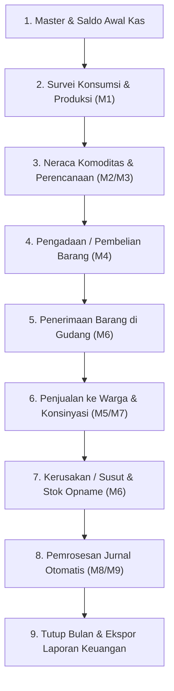

# Panduan Menuju 100% & Skenario Uji End-to-End (E2E) KDMP-V2

Dokumen ini adalah panduan praktis untuk memastikan seluruh sistem KDMP-V2 siap 100% untuk demo sidang skripsi dan pengujian komprehensif.

---

## BAGIAN I: 4 Langkah Teknis Menuju 100% (Checklist Persiapan)

Sebelum memulai demo atau pengujian di browser, jalankan 4 langkah persiapan berikut di terminal Anda:

### 1. Migrasi Database Terbaru
Jalankan migrasi untuk membuat tabel antrean outbox gudang (`antrean_jurnal_gudang`) dan struktur terbaru lainnya:
```bash
php artisan migrate
```

### 2. Update Master Template Transaksi (Seeder Template Baru)
Jalankan seeder agar template jurnal penerimaan (`PNB`), kerusakan (`KRG`), dan opname (`OPK`, `OPL`) terdaftar di database:
```bash
php artisan db:seed --class=TransaksiTemplateSeeder
```

### 3. Pastikan Queue Worker atau Scheduler Berjalan
Agar transaksi dari gudang otomatis diproses menjadi jurnal akuntansi:
* **Opsi A (Manual via Command - Sangat Cocok saat Demo):**
  Setiap kali selesai input data gudang, jalankan perintah ini di terminal untuk memproses antreannya:
  ```bash
  php artisan jurnal:proses-gudang
  ```
* **Opsi B (Otomatis via Queue Worker / Scheduler):**
  ```bash
  php artisan queue:work
  # atau
  php artisan schedule:work
  ```

### 4. Build Aset Frontend (Bila ada perubahan CSS/JS)
```bash
npm run build
```

---

## BAGIAN II: Skenario Alur Pengujian End-to-End (E2E)

Ikuti alur cerita pengujian ini dari awal sampai akhir. Skenario ini mencakup interaksi seluruh modul dari **M1 (Survei)** hingga **M9 (Tutup Buku Akuntansi)**.



---

### TAHAP 1: Inisialisasi Master & Saldo Awal (Modal BUMDes)
> **Tujuan:** Memastikan entitas BUMDes punya modal kas awal sebelum mulai beroperasi.

1. Login sebagai **Akuntan / Super Admin**.
2. Masuk ke menu **Akuntansi ➔ Saldo Awal**:
   - Isi saldo awal **Kas Utama / Kas Bank** (misal: Rp 50.000.000).
   - Isi akun lawannya **Modal Awal / Ekuitas Desa** (Rp 50.000.000).
   - Klik **Simpan**.
3. Cek menu **Keuangan ➔ Kas & Bank**: Pastikan saldo kas sudah tercatat Rp 50.000.000.

---

### TAHAP 2: Pengumpulan Data Survei Desa (Modul 1)
> **Tujuan:** Mengetahui kebutuhan konsumsi masyarakat desa dan potensi produksi pertanian lokal.

1. Buka menu **Survei**:
   - Buat sesi survei baru (atau gunakan sesi publik).
   - Input data responden rumah tangga (RT): jumlah anggota keluarga, konsumsi beras per minggu (misal: 10 kg).
   - Input data produsen/petani lokal: luas sawah, estimasi panen gabah/beras per bulan (misal: 200 kg).
   - Simpan dan lakukan **Validasi Survei**.

---

### TAHAP 3: Neraca Komoditas & Perencanaan Pengadaan (Modul 2 & 3)
> **Tujuan:** Sistem menghitung apakah desa surplus atau defisit komoditas.

1. Buka menu **Perencanaan ➔ Neraca Komoditas**:
   - Pilih komoditas **Beras**.
   - Sistem akan mengkalkulasi: `Total Kebutuhan Konsumsi - Total Produksi Lokal`.
   - Jika kebutuhan > produksi ➔ Status: **DEFISIT**.
2. Buka menu **Perencanaan ➔ Permintaan Pengadaan**:
   - Buat rekomendasi pengadaan untuk menutupi defisit tersebut (misal butuh 500 kg beras).
   - Bandingkan harga pemasok di fitur **Perbandingan Harga**.
   - Setujui pengadaan menjadi draf pembelian.

---

### TAHAP 4: Pembelian Barang dari Supplier / Petani (Modul 4)
> **Tujuan:** Mengadakan barang fisik menggunakan kas BUMDes.

1. Buka menu **Pembelian ➔ Buat Pembelian**:
   - Pilih supplier / petani rekanan.
   - Pilih barang: **Beras**, Qty: **100 kg**, Harga: **Rp 12.000/kg** (Total: Rp 1.200.000).
   - Jenis pembayaran: **Tunai** (menggunakan Kas Utama).
   - Simpan draf, lalu klik **Setujui / Approve Pembelian**.
2. **Cek Efek Keuangan:**
   - Masuk ke **Akuntansi ➔ Jurnal Umum**: Terbentuk otomatis jurnal pembelian:
     - *(D) Persediaan Sembako Rp 1.200.000*
     - *(K) Kas Utama Rp 1.200.000*
   - Saldo kas berkurang menjadi Rp 48.800.000.

---

### TAHAP 5: Penerimaan Fisik di Gudang (Modul 6)
> **Tujuan:** Mencatat kedatangan truk barang fisik ke rak gudang.

1. Buka menu **Gudang ➔ Penerimaan Barang**:
   - Buat penerimaan baru: Pilih Gudang Utama, Barang: **Beras**, Qty Masuk: **100 kg**, Harga: **Rp 12.000**.
   - Lampirkan ID Pembelian yang tadi dibuat di Tahap 4.
   - Klik **Simpan**.
2. **Cek Efek Gudang & Jurnal:**
   - Buka **Gudang ➔ Stok**: Qty beras on-hand bertambah menjadi 100 kg dengan HPP Rp 12.000.
   - Buka **Gudang ➔ Kartu Stok**: Tercatat mutasi masuk `IN`.
   - Jalankan `php artisan jurnal:proses-gudang`.
   - **Verifikasi Anti-Dobel Jurnal:** Karena penerimaan ini terkait pembelian, sistem **TIDAK** membuat jurnal persediaan baru, melainkan menautkan jurnal pembelian yang sudah ada ke kartu stok.

---

### TAHAP 6: Penjualan Warga & Konsinyasi Antar Desa (Modul 5 & 7)
> **Tujuan:** Menjual barang untuk mendapatkan pendapatan operasional BUMDes.

1. **Penjualan Langsung ke Warga:**
   - Masuk menu **Penjualan ➔ Transaksi Penjualan**:
   - Jual Beras sebanyak **30 kg** seharga **Rp 14.000/kg** (Total Bayar Rp 420.000, Tunai).
   - Simpan transaksi.
   - *Efek Otomatis:* Jurnal penjualan terbentuk (Kas bertambah, Pendapatan bertambah, HPP bertambah, Persediaan gudang berkurang 30 kg).
2. **Konsinyasi (Titip Jual ke BUMDes Desa Tetangga):**
   - Masuk menu **Konsinyasi ➔ Pengiriman Konsinyasi**:
   - Kirim **20 kg Beras** ke BUMDes Mitra.
   - *Efek Otomatis:* Stok reguler berpindah ke status persediaan konsinyasi.

---

### TAHAP 7: Kerusakan/Susut & Stok Opname Fisik (Modul 6)
> **Tujuan:** Menguji pemotongan stok non-penjualan dan sinkronisasi ke beban akuntansi.

1. **Uji Kerusakan / Susut Barang:**
   - Masuk menu **Gudang ➔ Kerusakan Barang**:
   - Catat: 5 kg beras susut/rusak dimakan hama (Nilai: 5 kg × Rp 12.000 = Rp 60.000).
   - Klik **Simpan**.
   - Stok fisik beras berkurang 5 kg.
2. **Uji Stok Opname:**
   - Masuk menu **Gudang ➔ Stok Opname**:
   - Sistem mencatat sisa stok beras seharusnya: 100 - 30 (jual) - 20 (titip) - 5 (rusak) = **45 kg**.
   - Masukkan hasil hitung fisik di rak: ternyata hanya ada **43 kg** (ada selisih kurang **2 kg** / Rp 24.000).
   - Klik **Simpan Opname**.

---

### TAHAP 8: Pemrosesan Antrean Jurnal Gudang (Outbox Process)
> **Tujuan:** Menguji bahwa Keuangan memposting transaksi gudang tanpa Gudang memanggil `JurnalService` langsung.

1. Buka terminal dan jalankan:
   ```bash
   php artisan jurnal:proses-gudang
   ```
2. **Hasil yang Harus Terlihat di Terminal:**
   ```text
   Memulai pemrosesan antrean jurnal gudang (limit: 50)...
   Pemrosesan selesai. Total berhasil diposting: 2 transaksi.
   ```
3. Buka menu **Akuntansi ➔ Jurnal Umum**:
   - Muncul jurnal baru untuk **Kerusakan Persediaan (KRG)**:
     - *(D) 641 Biaya Kerusakan & Susut Rp 60.000*
     - *(K) 1123 Persediaan Sembako Rp 60.000*
   - Muncul jurnal baru untuk **Selisih Kurang Opname (OPK)**:
     - *(D) 641 Biaya Kerusakan & Susut Rp 24.000*
     - *(K) 1123 Persediaan Sembako Rp 24.000*
4. Buka menu **Gudang ➔ Kartu Stok**: Kolom ID Jurnal pada baris kerusakan dan opname sudah otomatis terisi nomor jurnal resmi!

---

### TAHAP 9: Tutup Buku & Export Laporan Keuangan (Modul 8)
> **Tujuan:** Finalisasi pembukuan bulanan dan pencetakan hasil untuk sidang skripsi.

1. Buka menu **Akuntansi ➔ Tutup Bulan**:
   - Pilih bulan berjalan, lalu klik **Tutup Buku Bulan Ini**.
   - Sistem merekap seluruh mutasi jurnal ke tabel buku besar periode secara idempoten.
2. **Ekspor & Cetak Laporan Keuangan:**
   - Buka **Akuntansi ➔ Laporan ➔ Laba / Rugi**:
     - Klik tombol **"Export Excel (CSV)"** untuk mengunduh rincian penjualan, HPP, margin laba kotor, dan beban kerusakan.
     - Klik tombol **"Cetak / Simpan PDF"** untuk melihat tampilan siap print.
   - Buka **Akuntansi ➔ Laporan ➔ Neraca**:
     - Pastikan statusnya **BALANCE** (Total Aktiva = Total Passiva).
     - Klik **"Export Excel (CSV)"** dan **"Cetak / Simpan PDF"**.
   - Buka **Gudang ➔ Kartu Stok**:
     - Klik tombol **"Export Excel (CSV)"** untuk mengunduh mutasi barang fisik lengkap sebagai lampiran kartu stok gudang.

---

### Selesai! 🎓
Jika seluruh alur di atas berhasil dilalui tanpa error dan menghasilkan angka yang klop antara rak gudang dan lembar laba rugi, maka sistem Anda sudah **100% tervalidasi, terintegrasi, dan siap disidangkan**.
