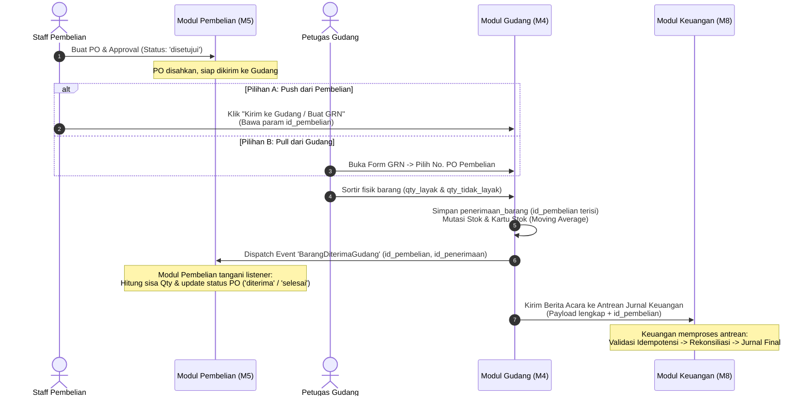

# 📋 Koordinasi Integrasi Goods Receipt Note (GRN) Pembelian dengan Gudang & Keuangan
**Project:** KDMP (Koperasi Desa Multi-Pihak)  
**Tujuan Dokumen:** Kesepakatan resmi alur integrasi antara Modul Pembelian (M5), Modul Gudang (M4), dan Modul Keuangan/Akuntansi (M8/Step Finance).

---

## 1. Ringkasan & Jawaban Cepat atas Pertanyaan

| Pertanyaan | Kesepakatan & Jawaban |
|---|---|
| **Bisakah modul Pembelian menyediakan alur GRN ke Gudang membawa `id_pembelian`?** | **Bisa sekali dan memang seharusnya demikian.** Modul Pembelian akan menyediakan tombol *"Kirim ke Gudang / Buat GRN"* yang mengarahkan ke form penerimaan Gudang dengan `id_pembelian` terisi otomatis. Gudang juga bisa *menarik (pull)* daftar PO berstatus siap terima. |
| **Status pembelian apa yang boleh diterima?** | Hanya status **`disetujui`** (Approved PO) dan **`diterima`** (jika penerimaan bertahap/belum lunas kuantitas). Status `draft`, `selesai`, dan `dibatalkan` **dilarang keras** diterima. |
| **Bagaimana menangani penerimaan sebagian/beberapa kali?** | Relasi **1 Pembelian (PO) -> N Penerimaan Barang (GRN)**. Gudang mengirim event `BarangDiterimaGudang` (membawa `idEntitas`, `idPembelian`, `idPenerimaan`). Listener di modul Pembelian menghitung akumulasi `qty_layak` dari seluruh GRN yang berstatus `diposting` secara idempoten, lalu memperbarui status PO menjadi `diterima` (sebagian) atau `selesai` (tuntas). Gudang **tidak mengubah status PO secara langsung**. |
| **Bagaimana mencegah persediaan tercatat dua kali?** | Gudang **tidak membuat dan tidak memposting jurnal**. Nilai persediaan di akuntansi dijaga dengan **Idempotency Guard & Reference Matching** menggunakan `id_pembelian`. Keuangan memvalidasi agar pengakuan persediaan (`PERSEDIAAN_UNIT`) hanya dilakukan **satu kali**. |
| **Apakah alur penjualan biasa sudah memanggil `StokService::keluar` & mendukung FEFO?** | **Belum (sedang disambungkan).** Penjualan saat ini masih memakai stub demo. Sesuai kesepakatan, penjualan barang biasa wajib memanggil `StokService::keluar()` di dalam `DB::transaction()` dengan `idBatch = null` agar Gudang otomatis memilih batch terdekat kedaluwarsa (**FEFO**). Jika stok kurang, transaksi di-rollback atomik. |
| **Apakah Penjualan sudah mendukung `id_stok_konsinyasi` & bagaimana kontrak mutasinya?** | **Belum.** Kolom di database sudah ada. Kontrak yang disepakati: baris konsinyasi **DILARANG memanggil `StokService` biasa**, melainkan memotong `stok_konsinyasi.qty_sisa`, menambah `qty_terjual`, mencatat mutasi ke `kartu_konsinyasi`, dan menjurnal via kode `KJL` (bukan `JTW`). |
| **Gudang mana yang dipakai POS jika satu entitas memiliki beberapa gudang?** | **SOP Disepakati:** Secara default POS memakai **Gudang Toko/Utama Entitas** (gudang aktif pertama / `is_default`), dengan dukungan opsi dropdown pemilihan gudang di form POS jika koperasi mengoperasikan lebih dari satu gudang fisik. |
| **Bagaimana integrasi rekomendasi surplus/defisit dari Gudang ke Pembelian & Penjualan?** | Menggunakan **Tabel Bersama (`rekomendasi_transaksi`)** + Domain Event. Rekomendasi muncul bilateral: di **Penjualan desa surplus** (calon pembeli = desa defisit) dan di **Pembelian desa defisit** (calon pemasok = desa surplus). **Roy yang memilih rekomendasi** untuk pre-fill form transaksi, dan transaksi baru tercipta saat Roy menyimpan form. |

---

## 2. Alur Integrasi End-to-End



---

## 3. Detail Kesepakatan Teknis

### A. Alur Pembuatan & Pengiriman GRN dari Pembelian

Modul Pembelian dan Gudang disepakati mendukung **dua pintu akses (Two-Way Entry)**:

1. **Push Flow (Dari Modul Pembelian):**
   - Pada halaman detail pembelian (`pembelian.show`), ketika status adalah `disetujui` atau `diterima`, tombol aksi **"Terima Barang di Gudang (GRN)"** aktif.
   - Tombol ini mengarahkan ke rute:
     ```text
     GET /gudang/penerimaan/create?id_pembelian={id_pembelian}
     ```
   - Halaman form penerimaan Gudang otomatis membaca query parameter `id_pembelian` dan mengunci input:
     - `id_pembelian`: ID terkait (disimpan ke `penerimaan_barang.id_pembelian`).
     - `id_pihak`: Supplier dari PO (read-only).
     - `id_gudang`: Gudang tujuan dari PO (read-only).
     - `items`: Item barang dari PO beserta sisa kuantitas yang belum diterima.

2. **Pull Flow (Dari Modul Gudang):**
   - Pada halaman form penerimaan Gudang (`gudang.penerimaan.create`), tersedia dropdown:
     **"Referensi Pembelian / PO (Opsional)"**.
   - Dropdown hanya menampilkan data pembelian dengan kriteria:
     - `id_entitas` = Entitas Koperasi aktif.
     - `status IN ('disetujui', 'diterima')`.
   - Jika staf gudang memilih PO tersebut, form otomatis mengisi vendor, gudang, serta rincian barang yang belum lunas diterima.
   - Jika penerimaan barang bukan dari PO formal (misalnya penerimaan saldo awal atau penyesuaian khusus non-pembelian), field ini boleh dikosongkan (`null`).

---

### B. Kesepakatan Status Pembelian

Status pada tabel `pembelian` menggunakan enum: `['draft', 'disetujui', 'diterima', 'selesai', 'dibatalkan']`.

| Status Pembelian | Boleh Diterima di Gudang? | Penjelasan Aturan Bisnis |
|---|:---:|---|
| **`draft`** | ❌ **DILARANG** | PO belum divalidasi oleh penanggung jawab pengadaan/manajer. Harga, item, atau vendor masih bisa berubah. |
| **`disetujui`** | ✅ **BOLEH** | Gerbang utama penerimaan. Menandakan PO sudah sah dan barang sedang dalam perjalanan / tiba di gerbang gudang. |
| **`diterima`** | ✅ **BOLEH (Parsial)** | Barang baru datang sebagian pada GRN sebelumnya. Masih boleh menerima pengiriman lanjutan selama kuantitas belum 100%. |
| **`selesai`** | ❌ **DILARANG** | Seluruh kuantitas barang sudah diterima lengkap (atau sudah di-close paksa). Tidak boleh ada GRN baru atas PO ini. |
| **`dibatalkan`** | ❌ **DILARANG** | Transaksi dibatalkan; barang tidak boleh diterima masuk ke aset gudang. |

> **Kasus Khusus Jalur Cepat (Petani Lokal / Kode `BPT`):**  
> Pada pembelian langsung dari warga/petani lokal di pos timbang (bayar kontan di tempat), transaksi dibuat langsung berstatus `disetujui` ➔ dibuatkan GRN instan ➔ status langsung menjadi `selesai` dalam satu alur terpadu.

---

### C. Penanganan Penerimaan Sebagian atau Beberapa Kali (Partial Receipt)

Kenyataan logistik di lapangan seringkali mengharuskan pengiriman bertahap (misal order 100 ton beras dikirim dengan 4 truk berbeda).

1. **Kardinalitas Relasi Database:**
   - 1 `pembelian` memiliki banyak (1 to N) `penerimaan_barang`.
   ```text
   pembelian (1) ────< penerimaan_barang (N) ────< penerimaan_barang_detail (N)
   ```

2. **Rumus Perhitungan Sisa Kuantitas (Outstanding Qty):**
   Untuk setiap baris barang dalam pembelian:
   $$\text{Sisa Qty} = \text{Qty Dipesan (PO)} - \sum (\text{Qty Layak pada seluruh GRN berstatus diposting})$$

3. **Validasi Input Gudang:**
   - Input kuantitas pada form GRN tidak boleh melebihi $\text{Sisa Qty}$.
   - Jika staf gudang menginput melebihi kuantitas sisa, sistem memberikan validasi gagal: *"Kuantitas melebihi sisa pesanan PO (Maksimal: X unit)"*.

4. **Transisi Status Pembelian Otomatis:**
   - **Saat GRN disimpan (Penerimaan Pertama / Parsial):**
     Jika $\sum \text{Qty Diterima} < \text{Total Qty PO}$, maka status pembelian berubah:
     $$\text{status} \leftarrow \text{'diterima'}$$
   - **Saat GRN Terakhir Disimpan (Penerimaan Tuntas):**
     Jika seluruh item pada PO telah terpenuhi ($\text{Sisa Qty} = 0$ untuk semua baris), maka status pembelian berubah:
     $$\text{status} \leftarrow \text{'selesai'}$$
   - **Penutupan Khusus (Short-Close / Force Closed):**
     Jika supplier mengonfirmasi sisa barang tidak dapat dikirim lagi, staf Pembelian memiliki tombol *"Tutup Pembelian (Selesai Parsial)"* agar PO tidak terus menggantung berstatus `diterima`.

5. **Batas Kewenangan Antar-Modul & Event `BarangDiterimaGudang`:**
   > [!IMPORTANT]
   > **Prinsip Domain Ownership:** Tabel `pembelian` adalah milik Modul Pembelian (M5). Modul Gudang **TIDAK BOLEH** mengeksekusi update database langsung (`pembelian.status = ...`) di dalam controller atau service Gudang.
   
   Untuk menjaga modularitas (*Separation of Concerns*), integrasi menggunakan pola **Event-Driven**:
   
   - **Trigger dari Gudang:** Setelah transaksi GRN berhasil tersimpan secara atomik, Modul Gudang menembakkan event:
     ```php
     namespace App\Events\Gudang;
     
     class BarangDiterimaGudang
     {
         public function __construct(
             public int $idEntitas,
             public int $idPembelian,
             public int $idPenerimaan,
         ) {}
     }
     ```
   
   - **Listener di Modul Pembelian (`App\Listeners\Pembelian\UpdateStatusPembelianDariGrn`):**
     Modul Pembelian mendengarkan event tersebut dan menghitung akumulasi penerimaan secara idempoten:
     ```php
     namespace App\Listeners\Pembelian;

     use App\Events\Gudang\BarangDiterimaGudang;
     use App\Models\Pembelian\Pembelian;
     use App\Models\Gudang\PenerimaanBarang;
     use Illuminate\Support\Facades\DB;

     class UpdateStatusPembelianDariGrn
     {
         public function handle(BarangDiterimaGudang $event): void
         {
             $pembelian = Pembelian::with('detail')
                 ->where('id_pembelian', $event->idPembelian)
                 ->where('id_entitas', $event->idEntitas)
                 ->lockForUpdate()
                 ->first();

             if (! $pembelian || in_array($pembelian->status, ['dibatalkan', 'draft'], true)) {
                 return;
             }

             // 1. Ambil seluruh GRN yang sah (hanya status 'diposting') untuk PO ini
             $grnSahIds = PenerimaanBarang::query()
                 ->where('id_pembelian', $event->idPembelian)
                 ->where('status', 'diposting')
                 ->pluck('id_penerimaan');

             if ($grnSahIds->isEmpty()) {
                 return;
             }

             // 2. Hitung akumulasi qty_layak per barang dari GRN sah
             $akumulasiPenerimaan = DB::table('penerimaan_barang_detail')
                 ->whereIn('id_penerimaan', $grnSahIds)
                 ->groupBy('id_barang')
                 ->select('id_barang', DB::raw('SUM(qty_layak) as total_layak'))
                 ->pluck('total_layak', 'id_barang');

             // 3. Bandingkan dengan kebutuhan PO per baris item
             $semuaLengkap = true;
             $adaYangDiterima = false;

             foreach ($pembelian->detail as $item) {
                 $diterima = (float) ($akumulasiPenerimaan[$item->id_barang] ?? 0);
                 $dipesan = (float) $item->qty_dasar;

                 if ($diterima > 0.0001) {
                     $adaYangDiterima = true;
                 }
                 if ($diterima < ($dipesan - 0.0001)) {
                     $semuaLengkap = false;
                 }
             }

             // 4. Update status PO secara idempoten
             $statusBaru = match (true) {
                 $semuaLengkap => 'selesai',
                 $adaYangDiterima => 'diterima',
                 default => 'disetujui',
             };

             if ($pembelian->status !== $statusBaru) {
                 $pembelian->update(['status' => $statusBaru]);
             }
         }
     }
     ```
   
   - **Jaminan Keamanan & Idempotensi (Re-process Safe):**
     * **State-Based Derivation:** Listener tidak menggunakan operator inkremental (`+1` atau `+= qty`), melainkan membaca total agregat langsung dari tabel `penerimaan_barang_detail` untuk GRN berstatus `diposting`. Jika event yang sama terkirim ulang (re-delivered) atau diproses beberapa kali, status akhir PO tetap konsisten dan tidak rusak.
     * **Filter Status Sah:** Hanya dokumen penerimaan dengan `status = 'diposting'` yang dihitung. GRN berstatus `draft` atau `dibatalkan` otomatis diabaikan.

   - **Tombol Navigasi di Halaman Detail PO (`pembelian.show`):**
     Pada view detail pembelian (`resources/views/pembelian/show.blade.php`), sediakan tombol tindakan:
     * **Kondisi Tampil:** Aktif saat `status IN ('disetujui', 'diterima')`.
     * **Teks Tombol:** *"Terima Barang di Gudang / Buat GRN"*
     * **Target URL:**
       ```html
       <a href="{{ url('/gudang/penerimaan/create?id_pembelian=' . $item->id_pembelian) }}" 
          class="btn btn-primary">
           <i class="ti ti-package-import"></i> Terima Barang di Gudang / Buat GRN
       </a>
       ```

6. **Penanganan Barang Rusak / Tidak Layak:**
   - Sesuai skema `penerimaan_barang_detail`, terdapat kolom `qty_layak` dan `qty_tidak_layak`.
   - **Hanya `qty_layak`** yang menambah stok fisik (`stok.qty_on_hand`) dan memperbarui `hpp_rata2`.
   - `qty_tidak_layak` tidak masuk ke stok aktif, melainkan dicatat dengan alasan dan foto bukti untuk otomatis dialirkan ke antrean **Retur Pembelian**.

---

### D. Pencegahan Pencatatan Persediaan Ganda (Double-Counting)

#### Analisis Masalah:
- Saat ini di `PembelianService::approvePembelian`, sistem membuat jurnal pembelian (`BTU` / `BTF` / `BKR`):
  - **Debit:** `Persediaan Barang (112x)`
  - **Kredit:** `Kas/Bank (111x)` atau `Hutang Dagang (2111)`
- Jika modul Gudang saat mencatat GRN juga mengirim payload yang memicu Keuangan mendebit `Persediaan Barang (112x)`, maka di Laporan Neraca koperasi, nilai persediaan tercatat **dua kali lipat (double-entry error)**.

#### Solusi yang Disepakati:

Sesuai pernyataan: *"Gudang tidak akan membuat atau memposting jurnal; bagian itu tetap ditangani Keuangan"*, maka disepakati arsitektur berikut:

```
┌────────────────────────────────────────────────────────┐
│                   MODUL GUDANG (M4)                    │
│  - Catat Fisik Barang (stok, kartu_stok, HPP Moving)   │
│  - BUKAN pencatat finansial                            │
│  - Kirim Berita Acara Penerimaan (GRN) ke Keuangan     │
└──────────────────────────┬─────────────────────────────┘
                           │ Payload Berisi:
                           │ id_pembelian, id_penerimaan,
                           │ qty_layak, subtotal_fisik
                           ▼
┌────────────────────────────────────────────────────────┐
│                  MODUL KEUANGAN (M8)                   │
│  Aturan Verifikasi Antrean & Idempotency Guard:        │
│                                                        │
│  Kondisi 1:                                            │
│  Apakah id_pembelian sudah menjurnal Persediaan?       │
│  ├── YA:                                               │
│  │   JANGAN debit Persediaan lagi!                     │
│  │   Tandai antrean sebagai VERIFIED_MATCHED           │
│  │   (Rekonsiliasi PO vs Fisik Sah)                    │
│  │                                                     │
│  └── TIDAK (Alur PO Baru / Bertahap):                  │
│      Jurnal dipicu bertahap senilai fisik yang datang: │
│      (D) Persediaan Barang                             │
│      (K) Hutang Belum Ditagih / Hutang Dagang          │
└────────────────────────────────────────────────────────┘
```

#### Aturan Idempotensi dan Rekonsiliasi di Modul Keuangan:
1. **Pemeriksaan Referensi Sumber (`sumber_tipe` & `sumber_id`):**
   - Keuangan memeriksa apakah untuk `sumber_tipe = 'PEMBELIAN'` dengan `sumber_id = id_pembelian` sudah terdapat `id_jurnal` aktif di tabel `jurnal_header`.
2. **Jika Jurnal Pembelian Sudah Terbit:**
   - Jurnal pembelian tersebut dianggap sebagai *Purchase Recognition*.
   - Antrean GRN dari gudang berfungsi sebagai **Validasi Kelayakan Pembayaran (Three-Way Matching Document)**.
   - Keuangan **TIDAK** mendebet ulang akun persediaan `112x`. Keuangan hanya mengubah status antrean penerimaan menjadi `'TERVERIFIKASI'` dan membuka hak bayar untuk staf kasir/hutang.
3. **Jika Jurnal Pembelian Belum Dibuat (Mengikuti Alur Gudang Dulu):**
   - Keuangan memposting jurnal penerimaan bertahap sesuai nilai barang yang benar-benar layak diterima di gudang:
     - **Debit:** Persediaan Barang (Unit terkait)
     - **Kredit:** Hutang Dagang (2111) atau Akrual Penerimaan Barang.

---

## 4. Struktur Payload Kontrak Antar-Modul

### Payload yang Dikirim Gudang ke Antrean Keuangan:

Ketika Gudang menyelesaikan penyimpanan GRN, Gudang menyertakan payload terstruktur berikut ke Keuangan:

```json
{
  "event": "PENERIMAAN_BARANG_GUDANG",
  "id_penerimaan": 105,
  "kode_penerimaan": "GRN-2026-11-0012",
  "tanggal_terima": "2026-11-07",
  "id_entitas": 1,
  "id_gudang": 2,
  "id_pihak": 14,
  "id_pembelian": 42,
  "kode_pembelian": "PBL-2026-11-0005",
  "status_penerimaan": "parsial", 
  "total_nilai_layak": 15000000.00,
  "items": [
    {
      "id_barang": 8,
      "kode_barang": "BRG-008",
      "nama_barang": "Beras Rojolele 25kg",
      "qty_layak": 50,
      "satuan_dasar": "KG",
      "harga_satuan_dasar": 12000.00,
      "subtotal": 600000.00
    }
  ],
  "catatan": "Penerimaan tahap 1 via truk AB 1234 CD. 2 sak rusak sobek dialihkan ke retur."
}
```

---

## 6. Koordinasi Integrasi Stok & Penjualan (Stok Biasa, FEFO Batch, & Konsinyasi)

### A. Alur Penjualan Barang Biasa & Pelacakan FEFO Batch

#### Status Implementasi Saat Ini:
1. **Penjualan belum memanggil `StokService::keluar`:**  
   Pada `app/Services/PenjualanService.php` (`createSale()`), penjualan masih menggunakan stub demo `availableDemoStock()` dengan angka dummy 100 unit. Transaksi penjualan yang `selesai` **belum memutasi** `stok.qty_on_hand` maupun mencatat baris di `kartu_stok`.
2. **Kesiapan Modul Gudang (`StokBatchService`):**  
   Modul Gudang **sudah siap 100% dan memiliki logika FEFO otomatis**.  
   Pada `StokService::keluar()`, sistem mengecek apakah `barang_per_koperasi.lacak_batch` aktif. Jika aktif:
   ```php
   $query->orderByRaw('tanggal_kedaluwarsa IS NULL')
         ->orderBy('tanggal_kedaluwarsa')
         ->orderBy('id_batch');
   ```
   Sistem Gudang secara otomatis mengalokasikan batch terdekat dengan tanggal kedaluwarsa (**FEFO**), memblokir batch yang sudah expired, dan mencatat pergerakan ke `kartu_stok_batch`.

#### Kontrak yang Diharapkan:
1. **Panggilan `StokService::keluar`:**  
   Saat transaksi penjualan final (`status = 'selesai'`), di dalam `DB::transaction()` pada `PenjualanService::createSale()`, kasir wajib memanggil `StokService::keluar` **satu kali** untuk setiap baris barang biasa non-konsinyasi:
   ```php
   app(\App\Services\StokService::class)->keluar(
       entitasId: $idEntitas,
       gudangId: $idGudang,
       barangId: (int) $idBarang,
       qty: (string) $quantity,
       refTipe: 'PENJUALAN',
       refId: (int) $sale->id_penjualan,
       createdBy: auth()->id(),
       tanggal: $sale->tanggal_transaksi,
       idBatch: null, // WAJIB NULL agar StokBatchService otomatis mengalokasikan secara FEFO
   );
   ```

2. **Jaminan Atomisitas Transaksi (Rollback Otomatis):**  
   Jika stok layak fisik tidak mencukupi (atau kuantitas batch yang belum kedaluwarsa kurang), `StokService::keluar()` akan melempar `RuntimeException` (misal: *"Stok tidak cukup"* atau *"Jumlah batch yang belum kedaluwarsa tidak mencukupi"*).  
   Karena pemanggilan berada di dalam `DB::transaction()`, maka:
   * **Seluruh transaksi penjualan otomatis dibatalkan (Full Rollback).**
   * Data `penjualan` dan `detail_penjualan` tidak tersimpan.
   * Uang kas/bank dan piutang tidak bertambah.
   * **Stok barang tidak berubah sebagian.**

---

### B. Alur Penjualan Barang Titipan Konsinyasi (`id_stok_konsinyasi`)

#### Status Implementasi Saat Ini:
1. Kolom `id_stok_konsinyasi` **sudah ada** pada tabel `detail_penjualan` dan flag `ada_baris_konsinyasi` sudah ada pada tabel `penjualan`.
2. Namun pada `PenjualanService::createSale()`, baris tersebut masih di-*hardcode* `'id_stok_konsinyasi' => null` dan `'ada_baris_konsinyasi' => false`. Kasir POS belum memuat barang dari `stok_konsinyasi`.

#### Prinsip Arsitektur (Isolasi Stok Titipan):
> [!CAUTION]
> **JANGAN PERNAH mencampur stok konsinyasi dengan stok biasa.**  
> Sesuai dokumen arsitektur `03-konsinyasi.md`, barang titipan **BUKAN ASET** koperasi penerima.  
> **DILARANG KERAS memanggil `StokService::keluar` untuk barang konsinyasi**, karena akan memotong fisik stok biasa dan mengacaukan HPP Moving Average serta Neraca Koperasi penerima.

#### Kontrak Integrasi Penjualan Konsinyasi yang Diharapkan:

1. **Di Antarmuka Kasir (POS):**
   - Menampilkan komoditas konsinyasi aktif dari `stok_konsinyasi` (`scopeDiKoperasi()`, `status = 'aktif'`, `qty_sisa > 0`).
   - Setiap item konsinyasi yang masuk keranjang membawa `id_stok_konsinyasi`, `harga_titip_satuan`, dan `harga_jual_satuan`.

2. **Penyimpanan Dokumen `penjualan` & `detail_penjualan`:**
   - Set header `penjualan.ada_baris_konsinyasi = true`.
   - Untuk baris konsinyasi pada `detail_penjualan`:
     - `'id_stok_konsinyasi' => $item['id_stok_konsinyasi']`
     - `'hpp_satuan_dasar' => 0` (koperasi tidak mengeluarkan modal HPP sendiri)
     - `'total_hpp' => 0`
     - `'harga_titip_satuan' => $stokKons->harga_titip_satuan` (hak pemilik barang)
     - `'harga_satuan' => $item['harga_jual']` (harga eceran ke pembeli)

3. **Mutasi Fisik Khusus Konsinyasi (`stok_konsinyasi`):**
   - Lock baris titipan dengan `StokKonsinyasi::lockForUpdate()`.
   - Validasi sisa stok: `qty_sisa >= $qtyJual`.
   - Update akumulasi:
     $$\text{qty\_terjual} \leftarrow \text{qty\_terjual} + \text{qty\_jual}$$
     $$\text{qty\_sisa} \leftarrow \text{qty\_sisa} - \text{qty\_jual}$$
   - Jika $\text{qty\_sisa} == 0$, ubah `status` menjadi `'selesai'`.

4. **Pencatatan Buku Kartu Mutasi Titipan (`kartu_konsinyasi`):**
   Catat mutasi pengeluaran langsung ke tabel `kartu_konsinyasi`:
   ```php
   \App\Models\Konsinyasi\KartuKonsinyasi::create([
       'id_stok_konsinyasi' => $stokKons->id_stok_konsinyasi,
       'tanggal' => $sale->tanggal_transaksi,
       'jenis_mutasi' => 'JUAL',
       'ref_tipe' => 'PENJUALAN',
       'ref_id' => $sale->id_penjualan,
       'qty' => $qtyJual,
       'harga_titip_satuan' => $stokKons->harga_titip_satuan,
       'harga_jual_satuan' => $hargaJual,
       'saldo_qty' => $stokKons->qty_sisa,
   ]);
   ```

5. **Pemisahan Jurnal Akuntansi (Double-Impact Konsinyasi):**
   - **Barang biasa:** Dijurnal via template `JTW` / `JTFW` (Kas D, Pendapatan K, HPP D, Persediaan K).
   - **Barang konsinyasi:** Dijurnal via template `KJL` pada buku desa penerima:
     - **Kas / Bank (111x)** (D) = Total bayar pembeli
     - **Hutang Konsinyasi (2117)** (K) = `qty * harga_titip_satuan` (hak pemilik)
     - **Pendapatan Imbalan Konsinyasi (417)** (K) = Selisih harga / komisi bersih koperasi penerima
   - **Buku Desa Pemilik:** Secara otomatis memicu jurnal pengakuan pendapatan `KAP` (Piutang Konsinyasi D / Pendapatan Konsinyasi K & HPP Konsinyasi D / Persediaan Konsinyasi K) jika penitip adalah entitas desa mitra.

---

### C. Kebijakan & Konfirmasi Penentuan Gudang POS untuk Multi-Gudang

#### Analisis Kondisi Codebase:
* Pada dokumentasi awal (`02-alur-modul.md` dan `ResolvesGudangAktif.php`), arsitektur dasar mengasumsikan **1 Koperasi Desa = 1 Gudang Utama**.
* Namun pada skema tabel `gudang`, entitas dimungkinkan memiliki lebih dari satu gudang (`unique(['id_entitas', 'kode_gudang'])`).
* Pada `PenjualanService.php` saat ini, kode mengambil gudang secara implisit:
  ```php
  $idGudang = Gudang::where('id_entitas', $idEntitas)->where('is_active', true)->orderBy('id_gudang')->value('id_gudang');
  ```

#### Kesepakatan & Rekomendasi Alur Multi-Gudang:
Untuk menghindari kesalahan potong stok pada entitas yang memiliki lebih dari satu gudang (misal: Gudang Utama/Pusat vs Gudang Toko/Kasir):

1. **Aturan Default (Single-Warehouse):**
   Jika entitas hanya memiliki 1 gudang aktif, sistem otomatis menggunakan gudang tersebut tanpa meminta input kasir.
2. **Aturan Multi-Warehouse (Opsi Fleksibel di POS):**
   - Form POS (`pos.blade.php`) menyediakan elemen dropdown **"Lokasi Toko / Gudang Kasir"**.
   - Dropdown memuat semua gudang aktif milik entitas (`Gudang::where('id_entitas', $idEntitas)->where('is_active', true)`).
   - Dropdown otomatis memilih gudang default (gudang pertama atau yang bertanda toko utama).
   - Nilai `id_gudang` dikirim dalam request `POST /penjualan`.
3. **Dampak ke Validasi & Pemotongan FEFO:**
   - Kueri cek stok kasir (`Stok::where('id_gudang', $idGudang)`) dan pemotongan `StokService::keluar()` dieksekusi **spesifik terhadap `id_gudang` yang dipilih**.
   - Ini memastikan stok yang dipotong oleh algoritma FEFO benar-benar berasal dari batch fisik yang ada di toko/gudang tempat transaksi kasir berlangsung.

---

## 8. Koordinasi Integrasi Rekomendasi Surplus–Defisit Antara Gudang, Pembelian, & Penjualan

### A. Mekanisme Pengiriman Data Rekomendasi ke Penjualan & Pembelian

#### 1. Status Eksisting di Modul Penjualan & Pembelian:
* **Modul Pembelian:** Form `PembelianController::create()` sudah memiliki variabel `$permintaanPembelianPending` yang membaca dari tabel `permintaan_pengadaan` (PR yang disetujui) dan fallback ke data contoh jika kosong.
* **Modul Penjualan:** Halaman `PenjualanController::create()` (`pos.blade.php`) sudah memiliki bagian *"Rekomendasi Penjualan dari Gudang"* (`$warehouseRecommendations`), yang saat ini masih berupa stub data contoh.
* **Kesimpulan:** Tempat (*UI placeholder*) sudah disiapkan oleh kedua modul, namun tabel dinamis perantara rekomendasi hasil pencocokan antardesa Gudang perlu diresmikan.

#### 2. Cara Gudang Mengirim Data Rekomendasi:
Sesuai arsitektur *Single Database Multi-Tenant* pada KDMP, metode terbaik adalah menggunakan **Tabel Bersama (Shared Entity / Table)**: `rekomendasi_transaksi` (atau menggunakan tabel `permintaan_barter` / `penawaran_barter` yang diperluas):
* Masing-masing entitas harus memberi persetujuan. Setelah persetujuan lengkap, Gudang mengalokasikan stok dengan urutan persetujuan lengkap, menaikkan `stok.qty_reserved`, dan menyiapkan rekomendasi berstatus `siap_dilempar`.
* Tombol **Lempar** di Gudang mengubah rekomendasi menjadi `menunggu`. Hanya setelah itu rekomendasi boleh tampil di modul Penjualan dan Pembelian; tombol ini tidak membuat transaksi atau PO.
* Halaman Gudang hanya menampilkan permintaan masuk dan keluar serta status persetujuannya. Perhitungan dan pencocokan data surplus-defisit tetap menjadi tanggung jawab modul Perencanaan Pengadaan.
* Notifikasi/event lintas modul belum diimplementasikan. Payload dan mekanisme konsumsi harus disepakati dengan pengembang Perencanaan, Penjualan, dan Pembelian sebelum integrasi lintas modul.

---

### B. Kontrak Struktur Data Rekomendasi

Data yang dikirimkan oleh Gudang dan diterima oleh modul Penjualan & Pembelian:

| Field | Tipe Data | Deskripsi & Contoh |
|---|---|---|
| `id_rekomendasi` | `bigint / uuid` | Primary key unik rekomendasi |
| `id_pengajuan_gudang` | `bigint / string` | ID unik kesepakatan surplus-defisit dari modul Gudang |
| `jenis_rekomendasi` | `enum('penjualan', 'pembelian')` | Menentukan modul mana yang menampilkan: `penjualan` (desa surplus) atau `pembelian` (desa defisit) |
| `id_entitas_asal` | `bigint` | Entitas desa pengirim / surplus (Penjual) |
| `id_entitas_tujuan` | `bigint` | Entitas desa penerima / defisit (Pembeli) |
| `id_pihak_mitra` | `bigint` | ID rekanan di tabel `master_pihak` yang mewakili desa mitra (wajib untuk transaksi) |
| `id_gudang` | `bigint nullable` | Gudang sumber untuk rekomendasi Penjualan atau gudang tujuan untuk rekomendasi Pembelian |
| `id_barang` | `bigint` | ID barang komoditas yang disepakati |
| `nama_barang` | `string` | Nama komoditas (misal: "Beras Rojolele 25kg") |
| `id_satuan` | `bigint` | Satuan transaksi (satuan dasar / KG) |
| `qty_disetujui` | `decimal(18,4)` | Kuantitas yang disepakati antar-desa |
| `harga_satuan_kesepakatan` | `decimal(18,2)` | **Tambahan Wajib:** Harga per unit yang disepakati antar-gudang (untuk auto-fill nominal transaksi) |
| `id_unit_usaha` | `bigint` | Unit usaha yang menaungi barang (misal Sembako) |
| `tgl_berlaku_sampai` | `datetime` | Batas kedaluwarsa rekomendasi (misal 48 jam) |
| `id_transaksi_terbentuk` | `bigint nullable` | ID transaksi yang dibuat operator modul terkait |
| `status` | `string` | `siap_dilempar`, `menunggu`, `diproses`, atau `kadaluarsa` |

---

### C. Alur Rekomendasi Bilateral (Desa Surplus vs Desa Defisit)

Ketika kesepakatan antar-gudang telah disetujui kedua belah pihak:

```
┌──────────────────────────────────────────────────────────────────┐
│                   GUDANG PUSAT / MATCHMAKING                     │
│  Kesepakatan: Desa A (Surplus 500 kg) -> Desa B (Defisit 500 kg) │
└─────────────────┬───────────────────────────────┬────────────────┘
                  │                               │
                  ▼                               ▼
     [Desa A: Entitas Surplus]       [Desa B: Entitas Defisit]
   ┌───────────────────────────┐   ┌───────────────────────────┐
   │      MODUL PENJUALAN      │   │      MODUL PEMBELIAN      │
   │  Tampil Rekomendasi Jual  │   │  Tampil Rekomendasi Beli  │
   │  - Calon Pembeli: Desa B  │   │  - Calon Pemasok: Desa A  │
   │  - Barang: Beras 500 kg   │   │  - Barang: Beras 500 kg   │
   │  - Menunggu Roy Kasir     │   │  - Menunggu Roy Pembelian │
   └───────────────────────────┘   └───────────────────────────┘
```

1. **Di Desa Surplus (Desa A):**
   * Rekomendasi muncul di modul **Penjualan (Kasir / POS)**.
   * Calon Pembeli: Entitas Desa B (terdaftar di `master_pihak`).
   * Mengurangi stok surplus dan membukukan piutang / kas masuk bagi Desa A.
2. **Di Desa Defisit (Desa B):**
   * Rekomendasi muncul di modul **Pembelian (Pengadaan)**.
   * Calon Pemasok: Entitas Desa A (terdaftar di `master_pihak`).
   * Menghasilkan Purchase Order (PO) untuk memenuhi kekurangan konsumsi pangan warga Desa B.

Persetujuan lengkap belum langsung menampilkan rekomendasi ke dua modul. Gudang harus menekan tombol **Lempar**; sesudah itu rekomendasi berstatus `menunggu` dan operator masing-masing modul tetap memilih apakah akan membuat transaksi.

---

### D. Peran Roy (Operator): Pemilihan Rekomendasi & Pembuatan Transaksi

> [!IMPORTANT]
> **Prinsip Segregation of Duties (Pemisahan Wewenang):**  
> Pengiriman rekomendasi dari Gudang **TIDAK PERNAH** membuat transaksi otomatis, tidak membuat PO di database, dan tidak membuka laci kasir. Rekomendasi bersifat murni *sinyal penawaran/kebutuhan* (*advisory*).

**Alur Kerja Roy (Operator):**
1. Roy membuka halaman Pembelian (`pembelian.create`) atau Penjualan (`penjualan.pos`).
2. Roy melihat daftar rekomendasi aktif yang berstatus `menunggu`.
3. Roy mengklik tombol **"Gunakan Rekomendasi"** pada baris yang dipilih.
4. Sistem membuka form transaksi dengan data yang **langsung terisi otomatis (*pre-filled*)**:
   - Pihak rekanan (supplier / pembeli) terisi desa mitra.
   - Barang, satuan, dan kuantitas terisi sesuai angka persetujuan.
   - Harga satuan terisi harga kesepakatan antar-gudang.
5. Roy melengkapi syarat komersial: metode bayar (tunai/transfer/kredit), rekening bank, dan tanggal jatuh tempo.
6. **Transaksi resmi baru tercipta saat Roy menekan tombol simpan/bayar:**
   - Pada Pembelian: Dokumen PO dibuat dengan status `disetujui` (atau draft).
   - Pada Penjualan: Dokumen Penjualan dibuat dengan status `selesai` dan memotong stok via `StokService::keluar`.

---

### E. Siklus Status Rekomendasi & Pencegahan Rekomendasi Ganda (Idempotency)

1. **Siklus Status:**
   * `siap_dilempar`: Kedua entitas telah menyetujui dan stok sumber sudah direservasi; belum terlihat oleh modul transaksi.
   * `menunggu`: Gudang sudah menekan tombol Lempar; rekomendasi dapat dipilih operator.
   * `diproses`: Operator telah menyimpan transaksi dan mengaitkan ID transaksi pada `id_transaksi_terbentuk`.
   * `ditolak`: Penolakan rekomendasi oleh operator belum tersedia pada integrasi saat ini.
   * `kadaluarsa`: Melewati batas waktu `tgl_berlaku_sampai` tanpa diproses.

2. **Pencegahan Pemrosesan Ganda (Anti-Double Processing):**
   - **Database Index Constraint:** Kombinasi `[id_pengajuan_gudang, jenis_rekomendasi, id_entitas]` bersifat unik.
   - **Pessimistic Locking (`lockForUpdate`):** Saat Roy menekan tombol simpan transaksi:
     ```php
     $rekomendasi = RekomendasiTransaksi::where('id_rekomendasi', $idRekomendasi)
         ->lockForUpdate()
         ->firstOrFail();

     if ($rekomendasi->status !== 'menunggu') {
         throw new \RuntimeException('Rekomendasi ini sudah pernah diproses atau tidak lagi valid.');
     }

     $rekomendasi->update([
         'status' => 'diproses',
         'id_transaksi_terbentuk' => $transaksiId,
         'diproses_oleh' => auth()->id(),
         'diproses_pada' => now(),
     ]);
     ```
   - Dengan penguncian baris ini, meskipun kasir/pembeli mengklik ganda (*double-click*), sistem mencegah terbentuknya PO atau nota penjualan kedua.

---

### F. Kebijakan Pencadangan Stok: `qty_reserved` vs Re-Check Realtime

Tabel `stok` di KDMP sudah memiliki kolom `qty_reserved`. Berdasarkan karakteristik transaksi antar-desa:

| Skenario Transaksi | Kebijakan Pencadangan | Penjelasan Mekanisme |
|---|:---:|---|
| **Transaksi Kargo Antar-Desa (Volume Besar)** | **Soft-Reservation (`qty_reserved`)** | Setelah kedua entitas menyetujui dan alokasi dibuat, Gudang menaikkan `stok.qty_reserved += qty`. Stok ini tidak bisa dijual oleh kasir ke warga lokal selama masa tunggu. Masa berlaku adalah 48 jam sejak persetujuan lengkap. Proses terjadwal Gudang melepaskan cadangan yang kedaluwarsa dan menandai rekomendasi sebagai `kadaluarsa`. |
| **Transaksi Fleksibel / Ritel Biasa** | **Re-Check Realtime (Just-In-Time)** | Stok fisik **tidak dikunci**. Ketika Roy membuka form dan menekan simpan, sistem memeriksa ulang: $\text{Stok Tersedia} = \text{qty\_on\_hand} - \text{qty\_reserved}$. Jika stok ternyata telah berkurang karena terjual di kasir, sistem menampilkan notifikasi: *"Stok aktual tidak mencukupi rekomendasi. Kuantitas disesuaikan dengan sisa yang ada atau batalkan."* |

> **Rekomendasi Standar KDMP:** Gunakan **Soft-Reservation dengan batas waktu 48 jam** untuk menjaga komitmen pasokan ke desa mitra yang sedang mengalami defisit, sehingga desa defisit tidak kecewa karena barang tiba-tiba habis sebelum PO diterbitkan.

**Batas integrasi saat ini:** Penjualan harus mengonsumsi reservasi rekomendasi ketika transaksi disimpan. Alur `PenjualanService` yang ada memakai `StokService::keluar()` biasa, yang mengurangi jumlah `qty_reserved` dari stok tersedia; karena itu pengembang Penjualan perlu menyediakan integrasi konsumsi reservasi sebelum rekomendasi ini digunakan untuk transaksi nyata.

---

## 9. Rencana Perubahan Kode (Action Items)

### 1. Modul Pembelian (`feature/pembelian-penjualan`):
- [ ] **Model Relationship:** Tambahkan relasi `penerimaan()` di `app/Models/Pembelian/Pembelian.php`.
- [ ] **Event Listener (`App\Listeners\Pembelian\UpdateStatusPembelianDariGrn`):**
  - Pasang listener untuk event `App\Events\Gudang\BarangDiterimaGudang`.
  - Hitung akumulasi `qty_layak` dari GRN berstatus `diposting` secara idempoten.
  - Perbarui status PO menjadi `'diterima'` jika penerimaan masih sebagian atau `'selesai'` jika seluruh kuantitas pesanan sudah terpenuhi.
- [ ] **View Button:** Pada `resources/views/pembelian/show.blade.php`, tambahkan tombol:
  *"Terima Barang di Gudang / Buat GRN"* aktif saat status `disetujui` atau `diterima`, mengarah ke:
  `/gudang/penerimaan/create?id_pembelian={$pembelian->id_pembelian}`.
- [ ] **Integrasi Rekomendasi Pembelian:** Ganti stub dummy di `PembelianController::create()` dengan query ke tabel `rekomendasi_transaksi` berstatus `menunggu` untuk entitas pembeli.

### 2. Modul Penjualan (`feature/pembelian-penjualan`):
- [ ] **Hapus Demo Stock:** Hapus ketergantungan pada `availableDemoStock()` dan gunakan pengecekan stok riil gudang.
- [ ] **Integrasi FEFO Barang Biasa:** Panggil `StokService::keluar()` dengan `idBatch = null` pada saat finalisasi penjualan (`createSale`) di dalam `DB::transaction()`.
- [ ] **Konsumsi Reservasi Rekomendasi:** Saat penjualan memakai rekomendasi Gudang, validasi rekomendasi dan gunakan reservasi `id_gudang`/barang dalam transaksi yang sama; jangan menolak stok hanya karena kuantitas itu sudah masuk `qty_reserved`.
- [ ] **Jaminan Atomisitas:** Tangkap exception jika stok/batch tidak mencukupi agar seluruh penjualan dibatalkan dan stok tidak berubah sebagian.
- [ ] **Dukungan Multi-Gudang POS:** Sediakan pilihan `id_gudang` pada POS (fallback ke gudang aktif pertama jika tunggal).
- [ ] **Isolasi Konsinyasi:** Pastikan item titipan (`id_stok_konsinyasi`) tidak memanggil `StokService::keluar()`, melainkan memotong `stok_konsinyasi.qty_sisa`, menulis `kartu_konsinyasi`, dan posting jurnal `KJL`.
- [ ] **Integrasi Rekomendasi Penjualan:** Tampilkan kartu rekomendasi penjualan dari tabel `rekomendasi_transaksi` di header kasir POS (`pos.blade.php`).

### 3. Modul Gudang (`feature/gudang-konsinyasi`):
- [ ] **Model Relationship:** Tambahkan relasi `pembelian()` di `app/Models/Gudang/PenerimaanBarang.php`.
- [ ] **Form Create Gudang:** Tangkap parameter `request('id_pembelian')` untuk pre-fill vendor, gudang, dan sisa item yang belum diterima.
- [ ] **Store Action Gudang & Dispatch Event:** Pada `PenerimaanBarangController::store()`:
  - Simpan dokumen dengan `'id_pembelian' => $data['id_pembelian'] ?? null`.
  - Mutasi fisik stok dan kartu stok.
  - **Tembakkan Event:** `event(new \App\Events\Gudang\BarangDiterimaGudang($header->id_entitas, $header->id_pembelian, $header->id_penerimaan));`
  - Teruskan payload ke antrean jurnal Keuangan dengan menyertakan `id_pembelian`.
- [x] **Persetujuan, alokasi FIFO, reservasi 48 jam, dan tombol Lempar:** Gudang menyiapkan rekomendasi setelah persetujuan kedua entitas; rekomendasi baru berstatus `menunggu` setelah dikirim secara eksplisit ke modul transaksi.

### 4. Modul Keuangan (`feature/finance`):
- [ ] **Idempotency Guard pada Consumer Antrean Jurnal:** Cegah duplikasi debit persediaan pada antrean GRN jika `id_pembelian` sudah dijurnal.
- [ ] **Jurnal Multi-Tipe Penjualan:** Tangani pemecahan jurnal jika dalam satu struk POS terdapat campuran barang milik sendiri (`JTW`) dan barang konsinyasi (`KJL`).

---
*Dokumen ini dibuat sebagai acuan kerja implementasi bersama tim KDMP.*

Berikut prompt yang sudah disesuaikan:
Integrasikan PR Gudang ke modul Pembelian. Buat tabel antrean rekomendasi sebagai bagian dari pekerjaan modul Gudang, lalu sediakan implementasi untuk kontrak App\Services\Pembelian\PurchaseRecommendationProvider yang sudah disiapkan di modul Pembelian.

Antrean yang dikirim ke Pembelian harus berjenis pembelian, ditujukan ke entitas aktif, dan berstatus menunggu. Data rekomendasi harus mencakup PR, barang, satuan, kuantitas, unit usaha, gudang, serta calon pemasok:
- Desa mitra yang surplus komoditas, beserta ketersediaan dan harga standar jualnya.
- Warga lokal yang memiliki komoditas tersebut, beserta ketersediaannya.
Saat operator memilih rekomendasi, form PO di Pembelian harus terisi dengan data tersebut. PO hanya dibuat setelah operator menyimpan form, lalu antrean ditandai telah diproses dan dikaitkan dengan PO. Jangan membuat atau menyetujui PO secara otomatis.

Jaga validasi agar rekomendasi hanya dapat digunakan oleh entitas tujuan dan tidak dapat diproses lebih dari sekali. Buat perubahan tabel dan integrasi di lingkup modul Gudang; gunakan kontrak provider Pembelian tanpa mengubah alur akuntansi.